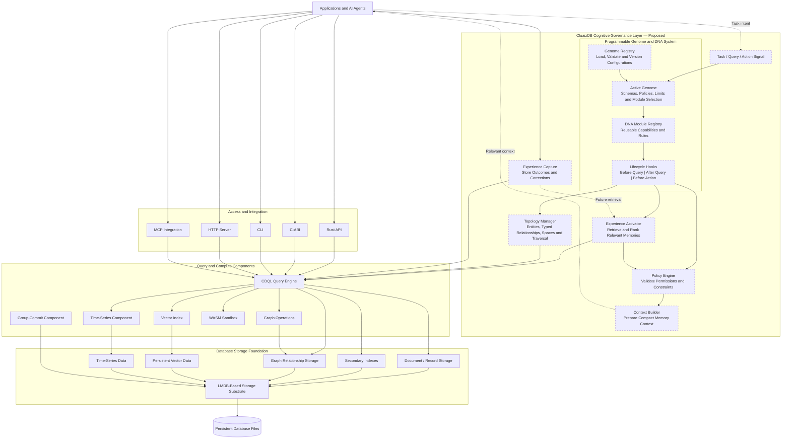
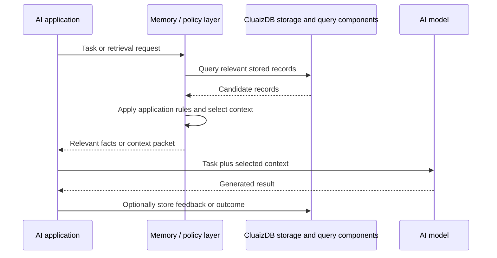

<p align="center">
  
</p>

<h1 align="center">CluaizDB</h1>

<p align="center">
  <strong>A Modular Database Substrate for Applications and AI Systems</strong>
</p>

<p align="center">
  <a href="https://www.rust-lang.org/"></a>
  <a href="LICENSE"></a>
  
</p>

CluaizDB is a Rust-based database project built around **LMDB** and a modular set of storage, indexing, query, and integration components. Its goal is to give applications a common foundation for working with records and, where supported by the implementation, vector similarity, graph relationships, time-series data, and AI-agent integrations.

CluaizDB is in **alpha**. Features and interfaces may change, and the current implementation should be evaluated against the source code and tests before being used for production-critical workloads.

## Contents

- [Why CluaizDB?](#why-cluaizdb)
- [Design principles](#design-principles)
- [Architecture](#architecture)
- [Data and query capabilities](#data-and-query-capabilities)
- [AI memory direction](#ai-memory-direction)
- [Repository layout](#repository-layout)
- [Build and test](#build-and-test)
- [CLI and integration interfaces](#cli-and-integration-interfaces)
- [Performance and benchmarks](#performance-and-benchmarks)
- [Project status and limitations](#project-status-and-limitations)
- [License](#license)

## Why CluaizDB?

Applications that use AI often need more than a place to store chat history. They may need to save structured facts, connect related records, retrieve semantically similar items, and expose selected data to an agent through a consistent interface.

CluaizDB explores these needs through a modular architecture:

- **Storage foundation:** persistent records built on LMDB.
- **Indexing and retrieval:** B+Tree-based lookups and a vector index component.
- **Relationships:** graph-oriented operations for connected data.
- **Queries:** CDQL, the project's query-engine component, intended to bring supported operations behind a common query interface.
- **Time-series support:** a component for time-oriented data and Gorilla-style compression.
- **Integration:** project components for HTTP, MCP, command-line, and C-ABI access.

These are project goals and component areas—not a claim that every feature is complete, production-hardened, or suitable for every workload. See [Project status and limitations](#project-status-and-limitations).

## Design principles

### 1. Keep storage separate from higher-level behavior

The storage substrate is responsible for persistence and low-level data access. Query planning, vector retrieval, graph operations, and application-specific behavior belong in separate components where practical.

This separation is intended to make the system easier to inspect, test, and evolve without forcing every application to use the same data model.

### 2. Support more than one way to access data

The repository includes or describes different access paths, including Rust-level access, a C-ABI bridge, a command-line application, HTTP endpoints, and MCP integration. Their exact availability and supported operations should be checked against the current build and API definitions.

### 3. Treat AI memory as a retrieval problem

A database can store facts and retrieve relevant records. It does not automatically make an AI model learn, reason correctly, or update its model weights. CluaizDB's AI-memory direction is to retrieve a small, relevant set of stored information for an application or agent to use.

### 4. Measure before making performance claims

Performance depends on hardware, data size, cache state, concurrency, durability settings, and query shape. Benchmark results should be published with reproducible commands and environment details rather than presented as universal latency guarantees.

## Architecture

The following diagram shows the **intended component relationships** at a high level. It is a logical architecture diagram, not a deployment diagram; it does not imply that these components run as separate microservices.



**How to read this diagram**

- **Access and integration** are ways an application may interact with the project. Not every interface necessarily supports every operation.
- **CDQL** is the query-engine component intended to parse and execute supported database queries.
- **Vector, graph, time-series, and WASM components** provide specialized functionality where implemented and enabled.
- **The storage substrate** is the persistence layer built around LMDB.
- **Group commit** is a write-coordination component in the repository. Its durability guarantees must be understood from its implementation and configuration.

The diagram describes logical relationships. It should not be read as proof that all adapters route through one executor today; that property should be verified in the code before being documented as a guarantee.

## Data and query capabilities

CluaizDB is organized around several data-access patterns.

| Area | Purpose | Notes |
| --- | --- | --- |
| Records and collections | Store and retrieve records by collection and identifier | The storage substrate is built around LMDB. |
| Secondary indexing | Find records using indexed terms or fields | Supported index types and query behavior depend on the current implementation. |
| Vector search | Retrieve approximate nearest neighbors for vector data | The repository contains an HNSW-style vector-index component; test coverage and persistence behavior should be checked for the version in use. |
| Graph operations | Represent and traverse relationships between records | Confirm the supported traversal algorithms and edge-update semantics in the current API. |
| Time-series data | Store or process values associated with time | The project includes a time-series component based on Gorilla-style compression techniques. |
| CDQL | Express supported queries through a query-engine interface | Syntax and supported operators are defined by the current parser, planner, and evaluator implementation. |
| WASM execution | Run WebAssembly-based transformations in a constrained environment | Available behavior and resource limits depend on the sandbox implementation and configuration. |

CluaizDB is intended to let these components work together where the current implementation supports the required operations. It should not be assumed that every data model has identical transaction, indexing, recovery, or query semantics.

## AI memory direction

One intended use case is persistent memory for AI applications and agents.

For example, an application could store a preference such as:

```json
{
  "subject": "user",
  "predicate": "prefers",
  "object": "red cars"
}
```

When a later task needs that preference, the application can query the database and include the relevant result in the model's context. The application—not the database alone—decides how to interpret the user's request and how to use retrieved information.

The broader roadmap explores a **Cognitive Governance Kernel** above the storage and query foundation. The proposed concepts include:

- **Genome:** a versioned configuration for a particular application or agent-memory setup.
- **DNA modules:** reusable, bounded capabilities or rules, such as preference retrieval or policy checks.
- **Topology:** a structured representation of entities and their relationships.
- **Experience activation:** selecting stored records that may be relevant to a current task.
- **Policy checks:** evaluating whether an operation is permitted under configured rules.
- **Feedback records:** storing outcomes or corrections for possible use in future retrieval.

These concepts describe the project's architectural direction. They should not be interpreted as a statement that a complete Genome/DNA runtime, automatic learning loop, or end-to-end cognitive workflow is already implemented in the current alpha release.

### Example of the intended memory flow



This is a target workflow. It does not imply that all steps are automatically orchestrated by CluaizDB today.

## Repository layout

The following paths are referenced by the project's current documentation. Check the repository tree for the exact crate names and availability in the version you are building.

| Path | Intended responsibility |
| --- | --- |
| `kernel-core/substrate` | LMDB-based physical storage and low-level record operations |
| `kernel-core/ffi` | C-ABI interface for in-process integration |
| `modules/cdql-query` | CDQL parsing, planning, and query execution |
| `modules/index-engine/mvhsnw-vector` | Vector nearest-neighbor index |
| `modules/time-series` | Time-series processing and compression |
| `modules/group-commit` | Write batching or commit coordination |
| `runtimes/wasmtime-sandbox` | WebAssembly execution sandbox |
| `api/mcp-spec` | MCP-related integration |
| `apps/server-http` | HTTP server and related endpoints |
| `apps/cli` | Command-line application |
| `tests/benchmarks` | Benchmark-related code, if present in the checked-out version |

The directory names and responsibilities above are based on project documentation and should be kept in sync with the actual workspace.

## Build and test

CluaizDB is a Rust project. You will need a compatible Rust toolchain and Cargo.

Clone the repository:

```bash
git clone https://github.com/cluaiz/cluaizdb.git
cd cluaizdb
```

Build the workspace:

```bash
cargo build --release
```

Run the workspace tests:

```bash
cargo test --workspace
```

These commands are the basic build and test entry points. A successful local build does not, by itself, establish production readiness, crash-safety under all workloads, or performance on other machines.

### Check available CLI commands

CLI subcommands can change during alpha development. Use the current binary's help output to discover the commands available in your checkout:

```bash
cargo run --release -p cluaizdb-cli -- --help
```

If the package name or command differs in your checkout, inspect the workspace manifests and the CLI's help output rather than relying on an outdated example.

## CLI and integration interfaces

The project documentation describes several integration options:

- **Rust:** for applications that use Rust and want direct library integration.
- **C-ABI:** for calling supported functions from languages or runtimes that can use a C-compatible interface.
- **HTTP:** for applications that need a network-accessible API.
- **MCP:** for AI-agent environments that communicate through the Model Context Protocol.
- **CLI:** for local development and database operations.

The precise API surface, supported commands, error behavior, and platform support should be taken from the current source and API definitions. This README intentionally avoids promising that a particular function, command, endpoint, or language binding is available unless it is verified for the release.

## Performance and benchmarks

CluaizDB's design emphasizes low-overhead local access and modular execution. Actual performance depends on the environment and workload.

No universal latency or throughput figures are stated here because benchmark claims should be accompanied by reproducible evidence, including:

- CPU, memory, storage device, and operating system.
- Rust version, build profile, and relevant feature flags.
- Dataset size, record and vector dimensions, and index configuration.
- Warm-cache versus cold-cache conditions.
- Concurrency level and read/write mix.
- Whether writes are buffered, committed, or synchronously durable.
- Benchmark source code, command, sample count, and statistical summary.

If benchmark results are published, include the exact command and environment and distinguish a microbenchmark from end-to-end application latency.

## Project status and limitations

CluaizDB is **alpha software**. Expect APIs and internal architecture to evolve.

Before relying on it for important data, evaluate the current implementation for your use case, particularly:

- Crash recovery and durability settings.
- Atomicity and consistency across records, indexes, vectors, and graph relationships.
- Concurrent read/write behavior and backpressure.
- Vector-index persistence and rebuild behavior.
- Query correctness, supported operators, and error handling.
- Authentication, authorization, and isolation requirements for network-accessible deployments.
- Resource limits and isolation for WebAssembly execution.
- Backup, restore, migration, and compatibility behavior.

A component being present in the repository does not automatically mean it is production-hardened. Likewise, a passing unit-test suite is useful evidence, but does not replace workload testing, failure testing, and reproducible benchmarks.

## Roadmap direction

The project's broad direction is to develop a dependable modular database foundation and then build higher-level AI-memory capabilities on top of it.

Potential areas of work include:

1. Verify and document current storage, indexing, query, and recovery behavior.
2. Define stable data contracts and error semantics across interfaces.
3. Improve consistency tests for secondary indexes, vectors, and graph relationships.
4. Validate query behavior and performance using reproducible workloads.
5. Develop the proposed Genome/DNA configuration and policy model.
6. Implement and evaluate an end-to-end experience-retrieval workflow.
7. Document API stability, compatibility, backup, and operational practices.

This is a direction of work, not a promise that every item is implemented in the current version.

## Contributing

Contributions, bug reports, and focused technical discussions are welcome. When reporting a bug, include:

- The CluaizDB commit or version.
- Operating system and Rust toolchain version.
- Minimal steps to reproduce the issue.
- Expected behavior and actual behavior.
- Relevant logs or test output, with secrets removed.

For performance reports, include the benchmark command and hardware details so that others can reproduce the result.

## License

The repository identifies its license as **Business Source License 1.1 (BSL 1.1)**. Read the [`LICENSE`](LICENSE) file in the repository for the authoritative terms, permitted uses, restrictions, and any change-license date. Do not rely on this summary as a substitute for the license text.

---

<p align="center">
  <strong>CluaizDB</strong><br>
  A modular foundation for persistent data, retrieval, and AI application memory.
</p>
'''

