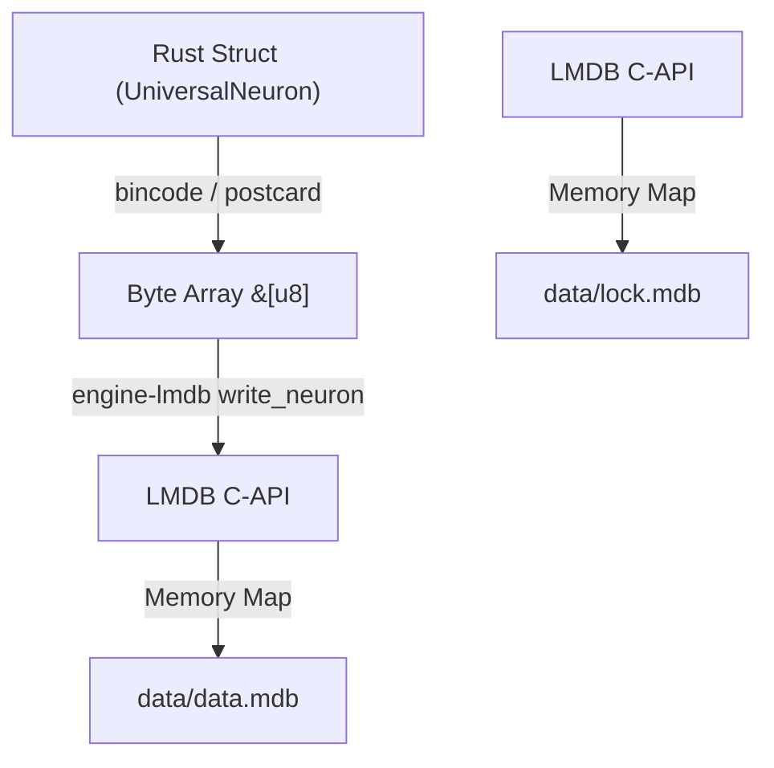

# 🗄️ crates/storage: The Physical Storage Layer

## 🎯 Deep Purpose
The `storage` crate (and its internal `engine-lmdb`) forms the bedrock of Cluaizd. It is a highly specialized wrapper around the C-based Lightning Memory-Mapped Database (LMDB) library. It handles the raw persistence of bytes to SSDs/NVMe drives, ensuring ACID compliance, MVCC (Multi-Version Concurrency Control), and memory-safe abstractions over C-pointers.

## 🏛️ Architectural Flow

## 🧬 Significant Files (Deep Code-Level Breakdown)

### `engine-lmdb/src/env.rs` (and `lib.rs`)
These files manage the complex, `unsafe` initialization of the LMDB environment.

**1. `LmdbEnv` Initialization**
- **Core Logic:** Maps the `data/` directory to virtual memory.
- **Execution Flow:** It configures the LMDB map size (e.g., 128 GB). This does *not* consume 128 GB of RAM; it simply reserves virtual address space. It sets flags like `MDB_NOSYNC` or `MDB_NOMETASYNC` based on the requested `Durability` level (Lite vs. Strict).
- **Why?** LMDB is written in C. Using it in Rust requires `unsafe` blocks because C does not respect Rust's borrow checker. This crate rigorously encapsulates those `unsafe` blocks, exposing a 100% safe Rust API to the rest of the workspace.

### `engine-lmdb/src/sensory_shard.rs`
- **Core Logic:** A specialized ephemeral storage ring buffer.
- **Execution Flow:** Unlike the main B+Tree which stores permanent memories, the Sensory Shard stores high-velocity temporary data (like WebRTC streams or IoT telemetry) that is overwritten once the buffer is full (e.g., limited to 10,000 entries).
- **Why?** B+Trees rebalance on insertion, which has overhead. The Sensory Shard bypasses deep tree balancing, acting purely as a transient cache. If a transient memory is deemed "important" by the DNA scripts, it is promoted from the Sensory Shard into the main Long-Term LMDB memory.
