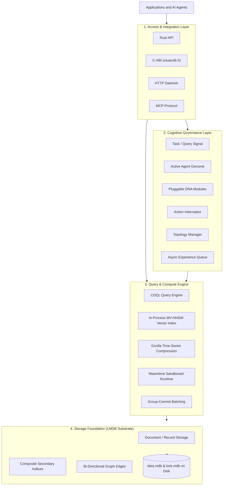

# 🧠 CluaizDB (0.1.0 Alpha) Documentation

> **Fact-Based, In-Process Cognitive Database Engine for AI Agents & Modern Applications**  
> *Zero External Daemons • Embedded Rust Substrate • Multi-Model Unified Storage • Wasm-Sandboxed Policy Governance*

---

## 🧭 Welcome to CluaizDB

CluaizDB is an embedded, multi-model cognitive database engineered in Rust. It provides persistent memory, multi-view vector search, time-series compression, and graph topology directly inside your process or over local IPC/MCP—without requiring Docker containers or heavy background daemons.

---

## ⚡ The Core Problem CluaizDB Solves

Traditional vector databases and external database stacks introduce major friction for local applications and AI agent workflows:

1. **Context Window Stuffing**: Agents dump thousands of raw history tokens into LLM prompts, exploding API costs and degrading model attention. CluaizDB retrieves structured, bounded memory packets (under 50 tokens) targeted specifically at what the agent needs.
2. **Docker & Network Tax**: Running Qdrant, Milvus, or Neo4j locally requires Docker containers, background services, and localhost TCP network hops for every query. CluaizDB runs **in-process** via memory-mapped LMDB, eliminating network hops.
3. **Fragmented Data Models**: Agents need key-value configs, relationship graphs, semantic vector embeddings, and chronological event streams. CluaizDB unifies all four storage models into one cohesive substrate queried through **CDQL (Cluaiz Database Query Language)**.

## 🏛️ Master System Architecture



---

## 🏗️ The 10 Concrete Production Crates

CluaizDB is not marketing hype or 30 phantom engines. The physical engine is built on **10 modular Rust crates**:

```
cluaizdb/
├── 📁 kernel-core/
│   ├── 🦀 substrate           # Persistent LMDB B+Tree storage engine & graph adjacency lists
│   ├── 🦀 cognitives          # Template Agent Genomes, Taxonomic Topology & Action Interceptors
│   └── 🦀 ffi                 # Plain C-ABI bridge and headers (cluaizdb.h) for C/Python
├── 📁 modules/
│   ├── 🦀 cdql-query          # Multi-model query parser, planner, and executor
│   ├── 🦀 index-engine/mvhsnw # In-process Multi-View HNSW vector index (Cosine & Euclidean)
│   ├── 🦀 time-series         # Gorilla delta-of-delta timestamp & value compression
│   └── 🦀 group-commit        # Lock-free double-buffered batch persistence
├── 📁 runtimes/
│   └── 🦀 wasmtime-sandbox    # Sandboxed WebAssembly policy validation with epoch fuel metering
├── 📁 api/
│   └── 🦀 mcp-spec            # Model Context Protocol (MCP) tool and resource handlers
└── 📁 apps/
    ├── 🦀 server-http         # Axum HTTP JSON-RPC & CDQL execution daemon
    └── 🦀 cli                 # Sovereign CLI admin & local pipeline execution tool
```

---

## 📚 Documentation Index (Mapped to `registry.json`)

### 1. 🌟 The Vision
- **[Why CluaizDB?](vision/why-cluaizdb.md)**: Problem statement: Docker tax, context stuffing, and fragmented storage stacks.
- **[Built for AI Agents](vision/for-ai-agents.md)**: Bounded memory packets (<50 tokens), multi-hop reasoning, and guardrails.

### 2. 🚀 Getting Started
- **[Introduction & Mental Model](get-started/introduction.md)**: The 4 core architectural layers.
- **[5-Minute Quickstart](get-started/quickstart.md)**: Add CluaizDB to your Rust project and run your first CDQL query.
- **[Installation & Toolchain](get-started/installation.md)**: Building and testing from source across platforms.
- **[Model Context Protocol (MCP)](get-started/mcp-integration.md)**: Connecting CluaizDB to Claude Desktop, Cursor, or Antigravity.

### 3. 🧠 Cognitive Governance
- **[Task Signals & Activation](cognitive-governance/signal-and-activation.md)**: Signal intake and associative experience activation.
- **[Programmable Genomes & DNA](cognitive-governance/genome-and-dna.md)**: Policy DNA, Preference DNA, and sandboxed Wasm DNA.
- **[Policy Engine & Context Builder](cognitive-governance/lifecycle-hooks-and-policies.md)**: Action interceptor routing and bounded <50 token context packets.
- **[Taxonomic Hierarchy & Topology](cognitive-governance/topology-manager.md)**: Multi-dimensional conceptual space and graph clusters.
- **[Async Experience Capture](cognitive-governance/experience-capture.md)**: Non-blocking double-queue telemetry and learning persistence.

### 4. ⚡ Query & Compute Engine
- **[CDQL Architecture & Pipeline](query-and-compute/cdql-overview.md)**: Query parsing AST, planning, and execution phases.
- **[CDQL Syntax Guide](query-and-compute/cdql-syntax-guide.md)**: Comprehensive reference for `find`, `get`, `filter`, `traverse`, `similar_to`, `join`, and aggregations.
- **[MV-HNSW Vector Index](query-and-compute/mvhsnw-vector-index.md)**: In-process Approximate Nearest Neighbor search and distance metrics.
- **[Gorilla Time-Series Compression](query-and-compute/gorilla-timeseries.md)**: Delta-of-delta timestamp and XOR floating-point compression.
- **[Wasmtime Sandboxing](query-and-compute/wasmtime-sandbox.md)**: Cranelift JIT, fuel limits, and memory isolation.
- **[Double-Buffered Group Commit](query-and-compute/group-commit.md)**: High-throughput batch persistence coordinator.

### 5. 🏛️ Storage Foundation
- **[Memory-Mapped B+Tree Substrate](storage-foundation/mmap-storage-substrate.md)**: LMDB mmap mechanics, 9 dedicated tables, and safe Rust copying.
- **[Bi-Directional Graph Storage](storage-foundation/bidirectional-graph-storage.md)**: Dual outbound/inbound tables and multi-hop graph traversal.
- **[Secondary Indexing & Ghost Purging](storage-foundation/secondary-indexing.md)**: Composite prefix seeks and zero ghost pointer guarantees.
- **[Disk Persistence & Durability](storage-foundation/disk-persistence.md)**: File layout, environment sizing, and ACID recovery.

### 6. 🔌 Access & Integration
- **[Embedded Rust API](access-and-integration/rust-api.md)**: Using CluaizDB directly within Rust applications.
- **[C-ABI FFI Bindings](access-and-integration/c-abi-ffi.md)**: `cluaizdb.h` headers for C, C++, Python, and Go linkage.
- **[HTTP JSON-RPC Server](access-and-integration/http-server.md)**: Axum daemon endpoints for CDQL, records, vectors, and health.
- **[MCP Server Reference](access-and-integration/mcp-server.md)**: Exposed tools (`db_ingest`, `db_query_vector`, `db_inspect_node`, `db_graph_trace`).
- **[CLI Command Reference](access-and-integration/cli-reference.md)**: Sovereign administrative binary for in-process CDQL, CRUD, and MCP invocation.

---

## 🛡️ Truth-in-Docs Guarantee

- **No Unverified Speed Claims**: We do not publish universal microsecond numbers measured on a single development machine. Latency depends on hardware, OS scheduler, and I/O bus speed.
- **No Fictional Engines**: Every paradigm documented maps to one of our 10 compiled Rust crates.
- **100% Tested**: The core substrate and cognitive engine pass all 49/49 unit and integration tests across the workspace.
