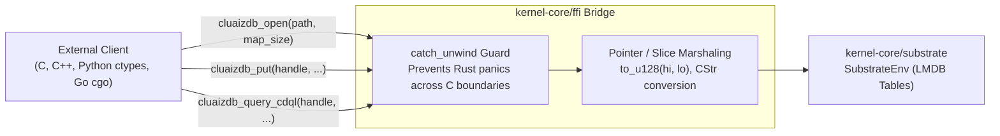

# ⚡ C-ABI Foreign Function Interface (`cluaizdb.h`)

> **Component:** `kernel-core/ffi` (`lib.rs`, `cluaizdb.h`)  
> **Export Type:** Stable C-ABI Dynamic / Static Linkage  
> **Reusability Level:** Universal Polyglot Bridge (C, C++, Python, Go, Zig, Node.js)  
> **Safety:** Catches Rust panics at FFI boundaries via `catch_unwind`

---

## 🧭 Architectural Flow: Polyglot FFI Boundary

The FFI subsystem allows external runtimes to interface directly with CluaizDB without running network daemons:



---

## 📄 C Header Specification (`cluaizdb.h`)

```c
#ifndef CLUAIZDB_H
#define CLUAIZDB_H

#ifdef __cplusplus
extern "C" {
#endif

#include <stdint.h>
#include <stddef.h>

/* Return Status Codes */
#define CLUAIZDB_OK                    0
#define CLUAIZDB_ERR_NULL_HANDLE      -1
#define CLUAIZDB_ERR_NOT_FOUND        -2
#define CLUAIZDB_ERR_BUFFER_TOO_SMALL -3
#define CLUAIZDB_ERR_STORAGE          -4
#define CLUAIZDB_ERR_PANIC            -5
#define CLUAIZDB_ERR_PARSE            -6

// Lifecycle
void* cluaizdb_open(const char* path, size_t map_size);
void  cluaizdb_close(void* handle);

// CRUD
int32_t cluaizdb_put(void* handle, uint32_t col_id, uint64_t id_hi, uint64_t id_lo, const uint8_t* payload, size_t payload_len);
int32_t cluaizdb_get(void* handle, uint32_t col_id, uint64_t id_hi, uint64_t id_lo, uint8_t* out_buf, size_t max_buf_len, size_t* out_len);
int32_t cluaizdb_delete(void* handle, uint32_t col_id, uint64_t id_hi, uint64_t id_lo);
int32_t cluaizdb_sync(void* handle);

// CDQL Query Pipeline
int32_t cluaizdb_query_cdql(void* handle, uint32_t col_id, const char* query_ptr, uint8_t* out_buf, size_t max_buf_len, size_t* out_len);

#ifdef __cplusplus
}
#endif

#endif
```

---

## 🐍 Python Integration Example (`ctypes`)

```python
import ctypes

# Load compiled library
lib = ctypes.CDLL("./target/release/cluaizdb_ffi.dll")

# 1. Signatures
lib.cluaizdb_open.argtypes = [ctypes.c_char_p, ctypes.c_size_t]
lib.cluaizdb_open.restype = ctypes.c_void_p

lib.cluaizdb_put.argtypes = [
    ctypes.c_void_p, ctypes.c_uint32, ctypes.c_uint64, ctypes.c_uint64,
    ctypes.c_char_p, ctypes.c_size_t
]
lib.cluaizdb_put.restype = ctypes.c_int32

lib.cluaizdb_close.argtypes = [ctypes.c_void_p]

# 2. Execution
handle = lib.cluaizdb_open(b"./data/py_db", 64 * 1024 * 1024)
payload = b'{"agent": "active"}'
rc = lib.cluaizdb_put(handle, 1, 0, 1001, payload, len(payload))
assert rc == 0
lib.cluaizdb_close(handle)
print("Successfully stored record via Python FFI!")
```
