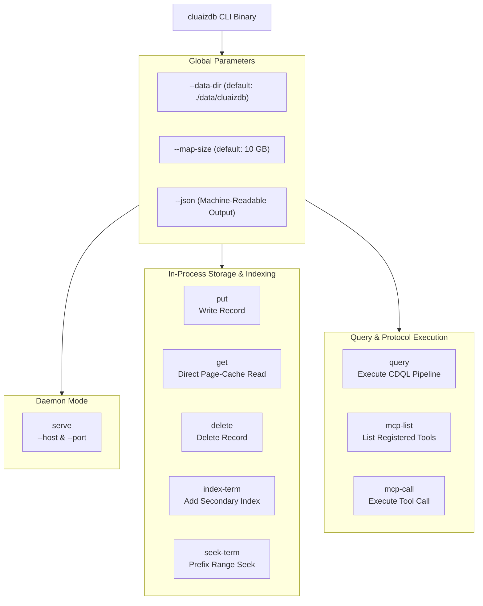

# 💻 Command Line Interface (CLI) Reference

> **The Sovereign Admin & Automation Tool for CluaizDB**  
> *In-Process CDQL Execution • Direct Point Reads • Secondary Index Seeks • MCP Tool Invocation*

The `cluaizdb` CLI binary (`apps/cli`) provides direct administrative control and scripting access to the database substrate without requiring an external daemon or network connection. It can also launch the sovereign HTTP and MCP server.

---

## 🧭 CLI Architecture & Command Surface



---

## ⚙️ Global Options

Every `cluaizdb` command accepts the following global flags:

| Flag | Type | Default | Description |
| :--- | :--- | :--- | :--- |
| `-d, --data-dir <PATH>` | `PathBuf` | `./data/cluaizdb` | Physical directory hosting `data.mdb` and `lock.mdb`. |
| `--map-size <BYTES>` | `usize` | `10737418240` (10 GB) | Virtual memory address space allocated for the LMDB environment. |
| `--json` | `bool` | `false` | Formats all command outputs as structured JSON for automation scripts. |

---

## 📋 Command Reference

### 1. `serve` — Launch Sovereign Daemon
Starts the Axum HTTP REST server and JSON-RPC Model Context Protocol (MCP) daemon.

```bash
# Launch server on custom host and port
cargo run --release -p cluaizdb-cli -- serve --host 127.0.0.1 --port 7331
```

- **Options**:
  - `-h, --host <STRING>`: Bind address (default: `0.0.0.0`).
  - `-p, --port <U16>`: Dedicated TCP port (default: `7331`). Auto-port hopping is disabled to maintain client stability.

---

### 2. `put` — Durably Store a Record
Writes a 128-bit decimal identified record into a collection using the double-buffered `GroupCommitter`.

```bash
# Store agent state record
cargo run --release -p cluaizdb-cli -- put --col 1 --id 1001 --payload '{"state":"active","fuel":850}'
```

- **Output (Human)**: `✅ [OK] Record 1001 durably written to collection 1`
- **Output (`--json`)**:
```json
{
  "status": "committed",
  "col": 1,
  "id": "1001"
}
```

---

### 3. `get` — Direct Page-Cache Point Read
Retrieves an owned byte slice directly from the memory-mapped page cache.

```bash
cargo run --release -p cluaizdb-cli -- get --col 1 --id 1001
```

- **Output (Human)**:
```text
⚡ Record 1001:
{"state":"active","fuel":850}
```
- **Output (`--json`)**:
```json
{
  "found": true,
  "col": 1,
  "id": "1001",
  "payload": "{\"state\":\"active\",\"fuel\":850}"
}
```

---

### 4. `delete` — Atomic Record Purge
Removes a record from the primary index and document tables.

```bash
cargo run --release -p cluaizdb-cli -- delete --col 1 --id 1001
```

- **Output (Human)**: `🗑️ [OK] Deleted record 1001`
- **Output (`--json`)**: `{"deleted": true, "id": "1001"}`

---

### 5. `index-term` — Insert Secondary Index Key
Maps a textual or numerical token into the composite B+Tree index (`ColID + Term + RecordID`).

```bash
cargo run --release -p cluaizdb-cli -- index-term --col 1 --term "active" --id 1001
```

- **Output (Human)**: `🔍 [OK] Indexed term 'active' -> 1001`
- **Output (`--json`)**: `{"status": "indexed", "term": "active", "id": "1001"}`

---

### 6. `seek-term` — Prefix Index Lookup
Performs a lexicographical prefix scan over the composite index DBI, returning matching 128-bit IDs.

```bash
cargo run --release -p cluaizdb-cli -- seek-term --col 1 --term "active"
```

- **Output (Human)**:
```text
🔍 Term 'active' matched 1 record(s):
   • 1001
```
- **Output (`--json`)**:
```json
{
  "term": "active",
  "matches": ["1001"]
}
```

---

### 7. `query` — In-Process CDQL Pipeline Execution
Parses, plans, and executes a multi-stage CDQL query pipeline against local storage.

```bash
cargo run --release -p cluaizdb-cli -- query --col 1 --query "find status == 'active' | limit 10"
```

- **Output (Human)**:
```text
⚡ [CDQL Execution in 12 µs] Matched 1 record(s):
[1] {"state":"active","fuel":850}
```
- **Output (`--json`)**:
```json
{
  "execution_time_us": 12,
  "count": 1,
  "records": [
    {
      "state": "active",
      "fuel": 850
    }
  ]
}
```

---

### 8. `mcp-list` — Inspect Native Tool Registry
Queries the local Model Context Protocol engine and returns all declared tool schemas in JSON-RPC 2.0 format.

```bash
cargo run --release -p cluaizdb-cli -- mcp-list
```

- **Output**:
```json
{
  "jsonrpc": "2.0",
  "id": 1,
  "result": {
    "tools": [
      {
        "name": "db_ingest",
        "description": "Durably store a document record into the Substrate storage engine",
        "inputSchema": { "type": "object" }
      },
      {
        "name": "db_query_vector",
        "description": "Perform Approximate Nearest Neighbor (ANN) search over vector index",
        "inputSchema": { "type": "object" }
      },
      {
        "name": "db_inspect_node",
        "description": "Direct point read of a record from the memory-mapped page cache",
        "inputSchema": { "type": "object" }
      },
      {
        "name": "db_graph_trace",
        "description": "Traverse directional graph edges from a source record",
        "inputSchema": { "type": "object" }
      }
    ]
  }
}
```

---

### 9. `mcp-call` — Direct Tool Execution
Simulates an AI Agent host tool call via the command line.

```bash
cargo run --release -p cluaizdb-cli -- mcp-call \
  --tool db_inspect_node \
  --args '{"collection": 1, "record_id": 1001}'
```

- **Output**:
```json
{
  "jsonrpc": "2.0",
  "id": 1,
  "result": {
    "content": [
      {
        "type": "text",
        "text": "{\"state\":\"active\",\"fuel\":850}"
      }
    ]
  }
}
```

---

## 🛠️ Shell Automation Scripting

Because every command supports `--json` and emits predictable exit codes, CluaizDB can be scripted in bash or PowerShell:

```bash
#!/usr/bin/env bash
set -e

DATA_DIR="./agent_runtime_db"

# 1. Ingest record
cargo run -q --release -p cluaizdb-cli -- --data-dir "$DATA_DIR" --json \
  put --col 1 --id 42 --payload '{"agent":"AlphaZero","generation":4}'

# 2. Extract payload using jq
RECORD=$(cargo run -q --release -p cluaizdb-cli -- --data-dir "$DATA_DIR" --json get --col 1 --id 42 | jq -r '.payload')
echo "Retrieved Payload: $RECORD"
```
