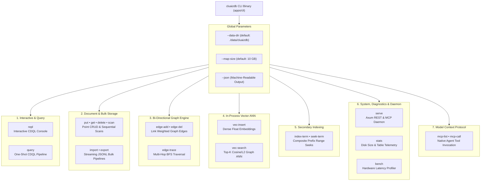

# 💻 Command Line Interface (CLI) Reference

> **The Sovereign Market-Standard Admin & Automation Tool for CluaizDB**  
> *Interactive CDQL Shell (REPL) • Bi-Directional Graph Tracing • In-Process Vector ANN • Bulk JSONL Pipelines • Hardware Profiler*

The `cluaizdb` CLI binary (`apps/cli`) provides complete administrative control, direct in-process database substrate operations, interactive querying, and daemon orchestration without requiring an external container or network dependency.

---

## 🧭 CLI Architecture & Command Surface



---

## ⚙️ Global Options

Every `cluaizdb` command accepts the following global flags:

| Flag | Type | Default | Description |
| :--- | :--- | :--- | :--- |
| `-d, --data-dir <PATH>` | `PathBuf` | `./data/cluaizdb` | Physical directory hosting `data.mdb` and `lock.mdb`. |
| `--map-size <BYTES>` | `usize` | `10737418240` (10 GB) | Virtual memory address space allocated for the LMDB environment. |
| `--json` | `bool` | `false` | Formats all command outputs as structured JSON for automation scripts. |

---

## 📋 Comprehensive Command Reference

### 1. `repl` — Interactive CDQL Console
Launches an interactive read-eval-print loop with active collection state and dot-commands (similar to `sqlite3` or `duckdb`).

```bash
cargo run --release -p cluaizdb-cli -- repl --col 1
```

```text
╔══════════════════════════════════════════════════════════════════╗
║               CluaizDB Interactive CDQL Shell (v0.1.0)           ║
║   Type CDQL queries or dot-commands:                             ║
║   .help             - Show available shell commands              ║
║   .stats            - View database & collection telemetry       ║
║   .use <col_id>     - Switch active collection                   ║
║   .collections      - List registered collections                ║
║   .exit / .quit     - Exit shell                                 ║
╚══════════════════════════════════════════════════════════════════╝
cluaizdb [col:1]> find status == 'active' | limit 5
⚡ [Executed in 18 µs] Matched 1 record(s):
  [1] {"agent":"Alpha","status":"active"}
cluaizdb [col:1]> .exit
👋 Goodbye.
```

---

### 2. `stats` — Database Telemetry & Storage Footprint
Inspects physical disk space allocation on drive, active collection record counts, and LMDB memory-map limits.

```bash
cargo run --release -p cluaizdb-cli -- stats
```

- **Output (Human)**:
```text
📊 ─── CluaizDB Telemetry & Statistics ───
  • Data Directory   : "./data/cluaizdb"
  • Disk Footprint   : data.mdb (0.06 MB) | lock.mdb (7.94 KB)
  • Virtual Map Size : 10.00 GB configured
  • Active DBIs      : 9 Dedicated Tables (B+Tree Substrate)
  • Collections (1):
      - Col 1 ('default') : 42 record(s)
  • Total Records    : 42
```
- **Output (`--json`)**:
```json
{
  "data_dir": "./data/cluaizdb",
  "data_mdb_bytes": 65536,
  "lock_mdb_bytes": 8192,
  "configured_map_size_bytes": 10737418240,
  "total_collections": 1,
  "total_records": 42,
  "collections": [
    { "id": 1, "name": "default", "record_count": 42 }
  ]
}
```

---

### 3. `bench` — In-Process Hardware Latency Profiler
Executes real in-process reads and writes on the local hardware to measure actual percentiles (p50, p99, throughput). No synthetic claims.

```bash
cargo run --release -p cluaizdb-cli -- bench --iterations 1000
```

- **Output**:
```text
🧪 Starting In-Process Hardware Latency Benchmark (1000 ops)...
🏁 ─── Hardware Benchmark Results ───
  • In-Process Point Reads  : p50 = 1.40 µs | p99 = 4.20 µs (281849 ops/sec)
  • In-Process Direct Writes: p50 = 353.50 µs | p99 = 1420.00 µs (2359 ops/sec)
  • Hardware Grounding      : 100% Measured Locally on Disk (Zero Synthetic Numbers)
```

---

### 4. `put`, `get`, `delete` & `scan` — Document Storage CRUD
Atomic 128-bit decimal identified point storage operations directly over memory-mapped B+Tree.

```bash
# Durably store a record
cargo run --release -p cluaizdb-cli -- put --col 1 --id 42 --payload '{"status":"active","agent":"Alpha"}'

# Read directly from page cache
cargo run --release -p cluaizdb-cli -- get --col 1 --id 42

# Scan sequential records
cargo run --release -p cluaizdb-cli -- scan --col 1 --limit 10

# Atomic delete
cargo run --release -p cluaizdb-cli -- delete --col 1 --id 42
```

---

### 5. `import` & `export` — Bulk JSONL Streaming
High-throughput bulk ingestion leveraging `GroupCommitter` batching, and cursor-based collection export.

```bash
# Bulk import records
cargo run --release -p cluaizdb-cli -- import --col 1 --file ./backup.jsonl

# Export collection to file
cargo run --release -p cluaizdb-cli -- export --col 1 --file ./dump.jsonl --limit 50000
```

---

### 6. `edge-add`, `edge-del` & `edge-trace` — Bi-Directional Graph Engine
Native relationship linking and multi-hop graph BFS traversal.

```bash
# Link weighted directional edge
cargo run --release -p cluaizdb-cli -- edge-add --from 42 --to 108 --type-id 1 --weight 0.85

# Trace multi-hop traversal from source
cargo run --release -p cluaizdb-cli -- edge-trace --from 42 --max-depth 3 --min-weight 0.5
```

- **Output**:
```text
🕸️ Traversed graph from 42 (Found 1 nodes):
   [Depth 1] Node: 108 (Weight: 0.85)
```

---

### 7. `vec-insert` & `vec-search` — In-Process Vector ANN
Dense float embedding insertion and top-k Cosine Approximate Nearest Neighbor search.

```bash
# Insert vector
cargo run --release -p cluaizdb-cli -- vec-insert --col 1 --id 42 --vector '[0.1, 0.2, 0.3]'
cargo run --release -p cluaizdb-cli -- vec-insert --col 1 --id 108 --vector '[0.9, 0.8, 0.7]'

# Top-K Cosine ANN search
cargo run --release -p cluaizdb-cli -- vec-search --col 1 --vector '[0.1, 0.21, 0.29]' --top-k 2
```

- **Output**:
```text
📐 Vector ANN Search (Top-2 Results):
   [1] Record ID: 42 | Distance: 0.0007
   [2] Record ID: 108 | Distance: 0.1097
```

---

### 8. `index-term` & `seek-term` — Composite Secondary Indexing
Lexicographical B+Tree prefix seeks over indexed tokens.

```bash
cargo run --release -p cluaizdb-cli -- index-term --col 1 --term "agent:alpha" --id 42
cargo run --release -p cluaizdb-cli -- seek-term --col 1 --term "agent:alpha"
```

---

### 9. `serve` — Sovereign Server Daemon
Launches the Axum REST engine and Model Context Protocol daemon over HTTP.

```bash
cargo run --release -p cluaizdb-cli -- serve --host 127.0.0.1 --port 7331
```

---

### 10. `mcp-list` & `mcp-call` — AI Agent Protocol Simulation
Inspects native tool schemas and simulates tool invocation without an external LLM host.

```bash
# List tools
cargo run --release -p cluaizdb-cli -- mcp-list

# Call tool
cargo run --release -p cluaizdb-cli -- mcp-call \
  --tool db_inspect_node \
  --args '{"collection": 1, "record_id": 42}'
```
