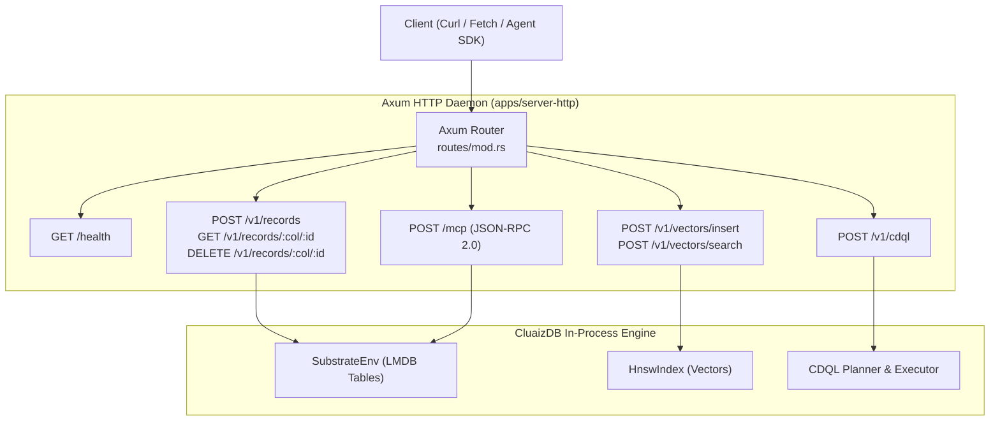

# 🌐 HTTP Server & JSON-RPC Gateway

> **Component:** `apps/server-http`  
> **Framework:** Tokio + Axum  
> **Reusability Level:** Local Network & REST Gateway  
> **Default Port:** `8080` (Binds to `127.0.0.1:8080`)

---

## 🧭 Architectural Flow: Axum Request Routing

The HTTP server daemon exposes the full multi-model capabilities of CluaizDB over local REST and JSON-RPC endpoints:



---

## 📡 Endpoints Specification

### 1. Health Status
- **`GET /health`**
- **Response**: `{"status": "healthy", "version": "0.1.0"}`

### 2. CDQL Query Execution
- **`POST /v1/cdql`**
- **Request Body**:
  ```json
  {
    "col_id": 1,
    "query": "find users(status = \"active\") -> limit 10"
  }
  ```
- **Response**:
  ```json
  {
    "status": "success",
    "records": [
      { "id": "1001", "data": { "name": "Alice", "status": "active" } }
    ]
  }
  ```

### 3. Record Operations
- **`POST /v1/records`**:
  ```json
  {
    "col_id": 1,
    "record_id": "1001",
    "payload": "{\"role\": \"architect\"}"
  }
  ```
- **`GET /v1/records/:col_id/:rec_id`**: Fetches record by ID.
- **`DELETE /v1/records/:col_id/:rec_id`**: Atomically deletes primary record, vector, and secondary index pointers.

### 4. Vector Operations
- **`POST /v1/vectors/insert`**: Inserts vector into substrate and HNSW index.
- **`POST /v1/vectors/search`**:
  ```json
  {
    "query": [0.15, -0.42, 0.88],
    "k": 5
  }
  ```

### 5. Model Context Protocol
- **`POST /mcp`**: Handles standard JSON-RPC 2.0 frames (`initialize`, `tools/list`, `tools/call`).
