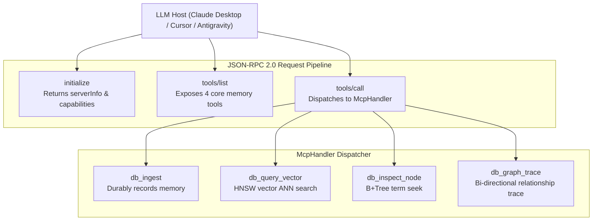

# 🤖 MCP Server & AI Agent Tool Reference

> **Component:** `api/mcp-spec` (`handler.rs`, `types.rs`)  
> **Protocol:** Anthropic Model Context Protocol (JSON-RPC 2.0)  
> **Reusability Level:** Agent Memory & Tool Execution Interface  
> **Supported Hosts:** Claude Desktop, Cursor, Antigravity IDE, LangChain / LlamaIndex

---

## 🧭 Architectural Flow: The MCP Tool Execution Loop

When Claude or an autonomous agent runs CluaizDB as an MCP server:



---

## 🛠️ Detailed MCP Tools Specification

### 1. `db_ingest`
- **Purpose**: Atomically and durably writes a memory fact or JSON document.
- **Parameters**:
  - `collection_id` (*integer*, optional, default: `1`): Target collection.
  - `record_id` (*string*, required): 128-bit decimal string or UUID.
  - `payload` (*string*, required): JSON or raw text memory payload.
- **Example Call**:
  ```json
  {
    "name": "db_ingest",
    "arguments": {
      "collection_id": 1,
      "record_id": "1001",
      "payload": "{\"preference\": \"prefers dark mode and Rust\"}"
    }
  }
  ```

### 2. `db_query_vector`
- **Purpose**: Fast in-process Approximate Nearest Neighbor search over dense float embeddings.
- **Parameters**:
  - `query` (*array of numbers*, required): Float array embedding.
  - `k` (*integer*, optional, default: `5`): Maximum candidates to return.
- **Example Call**:
  ```json
  {
    "name": "db_query_vector",
    "arguments": {
      "query": [0.15, -0.42, 0.88],
      "k": 5
    }
  }
  ```

### 3. `db_inspect_node`
- **Purpose**: B+Tree composite index prefix seek.
- **Parameters**:
  - `collection_id` (*integer*, optional, default: `1`): Target collection.
  - `term` (*string*, required): Search term (e.g. `status:active`, `user:1001`).
- **Example Call**:
  ```json
  {
    "name": "db_inspect_node",
    "arguments": {
      "collection_id": 1,
      "term": "status:active"
    }
  }
  ```

### 4. `db_graph_trace`
- **Purpose**: Navigates bi-directional relationship graphs starting from a root node.
- **Parameters**:
  - `node_id` (*string*, required): Starting node ID.
  - `direction` (*string*, optional, default: `"outbound"`): `"outbound"` or `"inbound"`.
  - `type_id` (*integer*, optional): Optional edge type filter.
- **Example Call**:
  ```json
  {
    "name": "db_graph_trace",
    "arguments": {
      "node_id": "1001",
      "direction": "outbound",
      "type_id": 1
    }
  }
  ```
