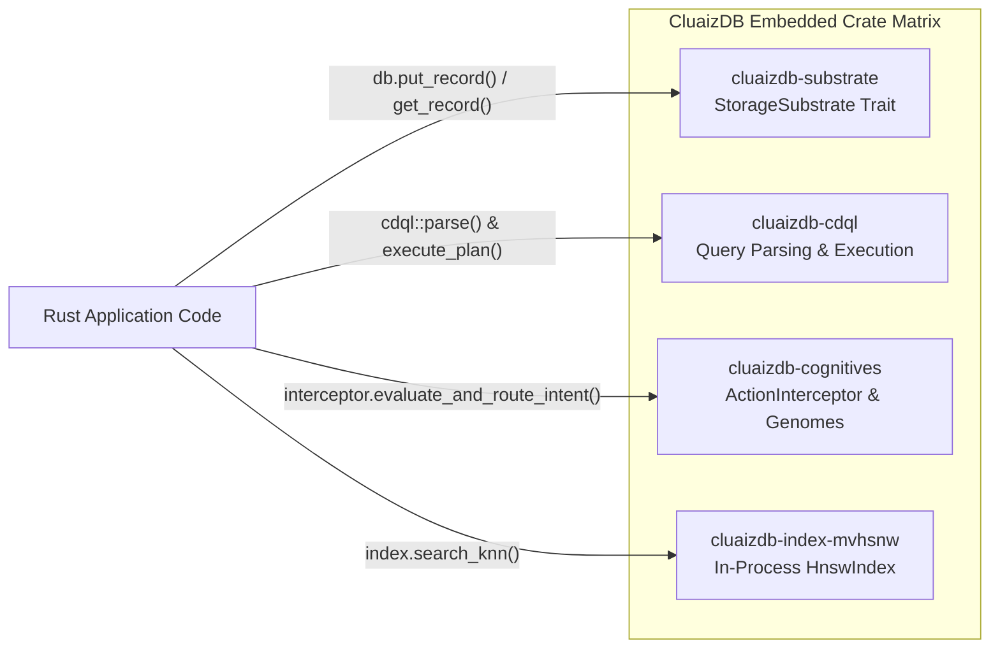

# 🦀 Embedded Rust API Reference

> **Component:** `cluaizdb` Workspace  
> **Interface:** Direct in-process Rust trait & struct linkage  
> **Reusability Level:** High-Performance Embedded Engine  
> **Concurrency Model:** Zero Network Hop, Thread-Safe `Send + Sync`

---

## 🧭 Architectural Flow: Embedded Process Linkage

Unlike external database services that force applications across network sockets, embedding CluaizDB directly into your Rust binary provides direct in-process access:



---

## 📦 Workspace Crates Matrix

| Crate Name | Path in Repository | Primary Responsibilities |
| :--- | :--- | :--- |
| `cluaizdb-substrate` | `kernel-core/substrate` | Persistent LMDB B+Tree storage engine, bi-directional graphs & traits |
| `cluaizdb-cdql` | `modules/cdql-query` | Multi-model query parser, AST, planner, and executor |
| `cluaizdb-cognitives` | `kernel-core/cognitives` | Agent genomes, policy DNA, action interceptors & compact serialization |
| `cluaizdb-index-mvhsnw` | `modules/index-engine/mvhsnw-vector` | In-process MV-HNSW vector Approximate Nearest Neighbor index |
| `cluaizdb-time-series` | `modules/time-series` | Facebook Gorilla timestamp and floating-point delta-of-delta compression |
| `cluaizdb-group-commit` | `modules/group-commit` | High-throughput asynchronous batch persistence coordinator |
| `cluaizdb-wasm-sandbox` | `runtimes/wasmtime-sandbox` | Cranelift JIT WebAssembly execution sandbox with fuel bounds |
| `cluaizdb-ffi` | `kernel-core/ffi` | Stable C-ABI bridge and headers (`cluaizdb.h`) |
| `cluaizdb-mcp` | `api/mcp-spec` | Model Context Protocol (MCP) tool and resource handlers |
| `cluaizdb-server-http` | `apps/server-http` | Axum HTTP JSON-RPC & CDQL execution daemon |

---

## 🦀 Complete End-to-End Embedded Example

```rust
use cluaizdb_substrate::{SubstrateEnv, StorageSubstrate, EdgeMetadata};
use cluaizdb_cdql::{parse, build_plan, execute_plan, QueryContext};
use std::sync::Arc;

fn main() -> Result<(), Box<dyn std::error::Error>> {
    // 1. Initialize Substrate with 64 MB virtual memory mapping
    let db = Arc::new(SubstrateEnv::open("./data/embedded_db", 64 * 1024 * 1024)?);
    let col_id = db.get_or_create_collection("agent_store")?;

    // 2. Put record
    let record_id = 1001u128;
    db.put_record(col_id, record_id, b"{\"role\": \"agent\", \"active\": true}")?;

    // 3. Put graph edge
    let meta = EdgeMetadata { weight: 1.0, created_at: 1000, valid_until: 2000 };
    db.add_edge(record_id, 1, 2002, meta)?;

    // 4. Query via CDQL pipeline
    let query_ast = parse("find agent_store(active = true) -> get 1 -> limit 5")?;
    let plan = build_plan(&query_ast)?;
    let mut ctx = QueryContext::new(Arc::clone(&db));
    let results = execute_plan(&plan, &mut ctx)?;

    println!("Query matched {} records.", results.records.len());
    Ok(())
}
```
