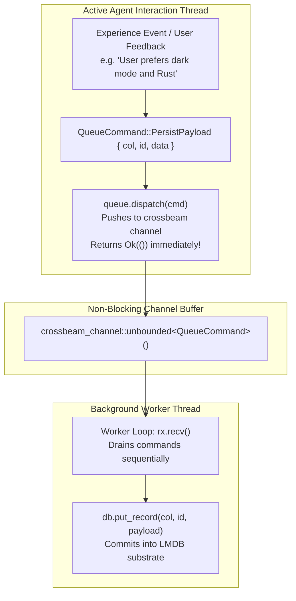
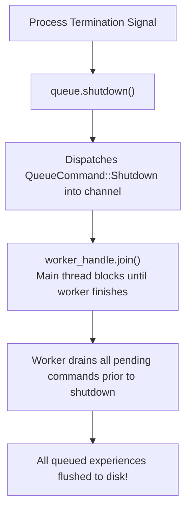

# 📥 Async Experience Capture Pipeline

> **Component:** `kernel-core/cognitives` (`async_queue.rs`)  
> **Underlying Pattern:** Asymmetric Non-Blocking Double Queue (`AsymmetricWriteQueue`)  
> **Reusability Level:** Agent Experience Recording & Asynchronous Feedback Persistence  
> **Contract:** Immediate caller return, zero interactive thread stalls, guaranteed graceful flush on shutdown

---

## 🧭 Architectural Flow: Non-Blocking Experience Logging

During interactive chat sessions or high-frequency reasoning loops, waiting synchronously for database commits causes perceptible lag.

The `AsymmetricWriteQueue` provides non-blocking command dispatching:



---

## 🛡️ Graceful Shutdown & Drain Guarantees

When an agent process terminates or restarts, losing in-flight experiences in memory is unacceptable.

The queue provides an explicit `shutdown()` barrier:



```rust
pub fn shutdown(self) {
    let _ = self.tx.send(QueueCommand::Shutdown);
    if let Some(handle) = self.worker.lock().take() {
        let _ = handle.join();
    }
}
```

---

## 🦀 Rust API Integration Example

```rust
use cluaizdb_cognitives::{AsymmetricWriteQueue, QueueCommand};
use cluaizdb_substrate::{SubstrateEnv, StorageSubstrate};
use std::sync::Arc;

fn main() -> Result<(), Box<dyn std::error::Error>> {
    let db = Arc::new(SubstrateEnv::open("./data/async_demo", 64 * 1024 * 1024)?);
    let queue = AsymmetricWriteQueue::new(Arc::clone(&db));

    // Non-blocking dispatch
    queue.dispatch(QueueCommand::PersistPayload {
        col: 1,
        id: 9999,
        data: b"{\"learned\": \"user prefers concise bullet points\"}".to_vec(),
    })?;

    // On shutdown, ensure all pending commands commit
    queue.shutdown();

    // Verify record is durably in LMDB substrate
    let read_back = db.get_record(1, 9999)?;
    assert!(read_back.is_some());
    println!("Durable experience verified on disk!");

    Ok(())
}
```
