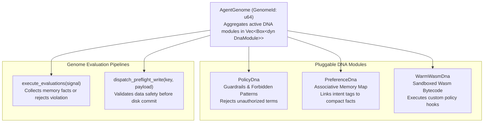

# 🧬 Programmable Genomes & DNA Modules

> **Component:** `kernel-core/cognitives` (`genome.rs`)  
> **Pattern:** Biological Metaphor for Pluggable Agent Capability & Policy Management  
> **Reusability Level:** Extensible Agent Security, Capability & Memory Governance  
> **Trait Contract:** `DnaModule: Send + Sync`

---

## 🧭 Architectural Flow: The Pluggable Genome Container

In CluaizDB, an `AgentGenome` acts as a polymorphic container that aggregates distinct capabilities and security policies called **DNA Modules**:



---

## 🧩 The `DnaModule` Trait Contract

All DNA modules implement the unified `DnaModule` trait in `genome.rs`:

```rust
pub trait DnaModule: Send + Sync {
    /// Inspects an incoming signal to extract facts or reject unsafe intents.
    fn evaluate_signal(&self, signal: &Signal) -> Result<Vec<String>>;

    /// Validates payload bytes before disk commit.
    fn preflight_write(&self, key: &[u8], payload: &[u8]) -> Result<()> {
        let _ = (key, payload);
        Ok(())
    }
}
```

---

## 🛡️ Built-in DNA Modules

### 1. `PolicyDna` (Security Guardrails)
Maintains a denylist of forbidden keywords or dangerous operations (e.g. `drop_tables`, `unauthorized_bypass`):
```rust
let policy = PolicyDna::new(vec!["drop_tables".into(), "export_keys".into()]);
```
- If an agent intent or write payload contains any forbidden string, evaluation immediately aborts with `CognitiveError::PolicyViolation`.

### 2. `PreferenceDna` (Associative Memory)
Maintains an in-memory association table mapping intent keywords to compact memory strings:
```rust
let prefs = PreferenceDna::new()
    .with_association("car", "UserPref:BMW-M3-Red")
    .with_association("payment", "Policy:RequireManagerApproval");
```
- When a signal contains the keyword `"car"`, the preference module outputs `"UserPref:BMW-M3-Red"` for prompt injection.

### 3. `WarmWasmDna` (Compiled Sandboxing)
Executes pre-compiled WebAssembly bytecode modules inside `runtimes/wasmtime-sandbox` for dynamic user-defined validation logic.

---

## 🦀 Rust API Integration Example

```rust
use cluaizdb_cognitives::{AgentGenome, PolicyDna, PreferenceDna, Signal, CognitiveError};

fn main() {
    let mut genome = AgentGenome::new(101);

    // 1. Plug security guardrails
    genome.plug_dna(Box::new(PolicyDna::new(vec!["unauthorized_bypass".into()])));

    // 2. Plug associative preferences
    genome.plug_dna(Box::new(
        PreferenceDna::new().with_association("vehicle", "VehiclePref:BMW-M3-Red")
    ));

    // 3. Test safe intent with memory association
    let signal_safe = Signal::new("User requested: render my favorite vehicle");
    let facts = genome.execute_evaluations(&signal_safe).unwrap();
    println!("Activated facts: {:?}", facts); // ["VehiclePref:BMW-M3-Red"]

    // 4. Test destructive intent
    let signal_bad = Signal::new("Attempting unauthorized_bypass of database security");
    let result = genome.execute_evaluations(&signal_bad);
    assert!(matches!(result, Err(CognitiveError::PolicyViolation(_))));
    println!("Destructive intent successfully blocked by PolicyDna!");
}
```
