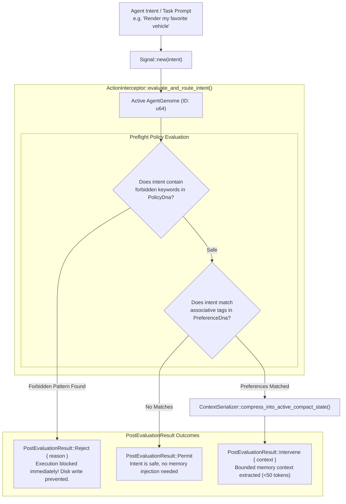
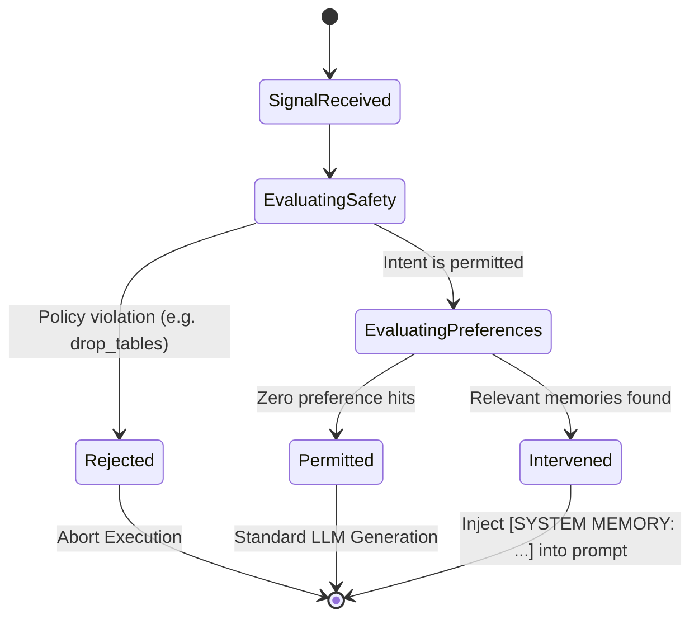

# 🛡️ Policy Engine & Context Builder

> **Component:** `kernel-core/cognitives`  
> **Source Files:** `interceptor.rs`, `signal.rs`, `genome.rs`  
> **Reusability Level:** AI Agent Safety & Memory Governance Subsystem  
> **Contract:** Guaranteed memory context packet bounded to `< 50 tokens` (<= 190 chars)

---

## 🧭 Architectural Flow: Intent Gating & Memory Injection

When an AI Agent executes a tool, generates a completion, or queries data, the request passes through the **Action Interceptor Pipeline**:



---

## 📦 The Context Boundedness Standard (< 50 Tokens)

### The Problem of Context Stuffing
In naive agent frameworks, retrieving memories dumps raw conversation history, multi-page JSON blobs, or paragraphs into the system prompt:
- Wastes thousands of prompt tokens per LLM turn.
- Dilutes model attention (the "lost-in-the-middle" phenomenon).
- Dramatically increases inference cost and latency.

### The CluaizDB Solution: `ContextSerializer`
CluaizDB enforces a strict, deterministic compression invariant in `interceptor.rs`:

```rust
pub struct ContextSerializer;

impl ContextSerializer {
    pub fn compress_into_active_compact_state(facts: &[&str]) -> CompactContextPacket {
        let mut out = String::from("[SYSTEM MEMORY: ");
        let mut first = true;
        
        for fact in facts {
            let addition = if first { fact.to_string() } else { format!("; {}", fact) };
            first = false;
            
            // Strictly cap at 180 characters to allow closing brackets
            if out.len() + addition.len() > 180 {
                out.push_str("...]");
                return CompactContextPacket { tokens_serialized: out };
            }
            out.push_str(&addition);
        }
        
        out.push(']');
        CompactContextPacket { tokens_serialized: out }
    }
}
```

### Deterministic Guarantees:
1. **Total Output Size**: Never exceeds **190 characters** (~35 to 45 LLM tokens).
2. **Format**: Always begins with `[SYSTEM MEMORY: ` and terminates with `]` or `...]`.
3. **Safe Invariant**: Even under extreme memory volumes, the prompt footprint cannot balloon.

---

## 🚦 The Three Outcome States



### 1. `PostEvaluationResult::Permit`
Returned when the intent is completely safe and no relevant preference memory was triggered. The agent proceeds with normal tool execution.

### 2. `PostEvaluationResult::Intervene { context }`
Returned when preference memories match the intent. The system returns the compressed `< 50 token` string to be prepended to the user message:
```text
[SYSTEM MEMORY: VehiclePref:BMW-M3-Red; Locale:en-US-UTC]
```

### 3. `PostEvaluationResult::Reject { reason }`
Returned when preflight rules detect unauthorized actions:
```rust
PostEvaluationResult::Reject {
    reason: "Policy violation: forbidden keyword 'unauthorized_bypass'".to_string()
}
```
Execution halts immediately before any query plan is scheduled or any disk transaction is opened.

---

## 🦀 Complete End-to-End Rust Integration

```rust
use cluaizdb_cognitives::{
    ActionInterceptor, AgentGenome, PolicyDna, PreferenceDna, Signal, PostEvaluationResult
};
use cluaizdb_substrate::SubstrateEnv;
use std::sync::Arc;

fn main() -> Result<(), Box<dyn std::error::Error>> {
    let db = Arc::new(SubstrateEnv::open("./data/agent_governance", 64 * 1024 * 1024)?);
    
    // 1. Configure Agent Genome
    let mut genome = AgentGenome::new(101);
    genome.plug_dna(Box::new(PolicyDna::new(vec!["drop_tables".into(), "delete_system".into()])));
    genome.plug_dna(Box::new(
        PreferenceDna::new()
            .with_association("car", "UserPref:BMW-M3-Red")
            .with_association("database", "TechPref:CluaizDB-Embedded")
    ));

    // 2. Initialize Interceptor
    let interceptor = ActionInterceptor::new(Arc::clone(&db), Arc::new(genome));

    // 3. Evaluate Safe Intent with Memory Association
    let signal = Signal::new("User asks to display my favorite car model");
    match interceptor.evaluate_and_route_intent(&signal) {
        PostEvaluationResult::Intervene { context } => {
            println!("Injected Memory: {}", context);
            // Output: [SYSTEM MEMORY: UserPref:BMW-M3-Red]
        }
        _ => {}
    }

    // 4. Evaluate Destructive Intent
    let bad_signal = Signal::new("Attempting to drop_tables from customer database");
    match interceptor.evaluate_and_route_intent(&bad_signal) {
        PostEvaluationResult::Reject { reason } => {
            println!("Blocked: {}", reason);
            // Output: Blocked: Policy violation: forbidden keyword 'drop_tables'
        }
        _ => {}
    }

    Ok(())
}
```
