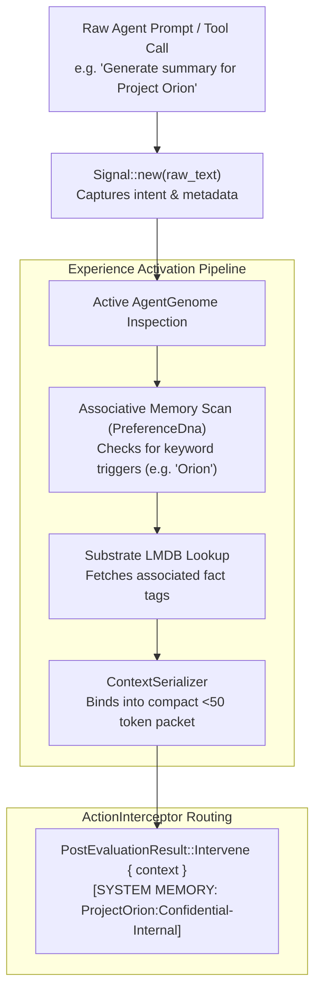

# 📡 Task Signals & Experience Activation

> **Component:** `kernel-core/cognitives` (`signal.rs`, `interceptor.rs`)  
> **Pattern:** Sensory Intake & Associative Memory Activation Pipeline  
> **Reusability Level:** AI Agent Task Orchestration & Memory Recall  
> **Output Type:** Typed PostEvaluationResult (Permit, Intervene, Reject)

---

## 🧭 Architectural Flow: Sensory Intake to Memory Activation

In cognitive architectures, an agent's raw input prompt or tool invocation is treated as a **sensory signal**.

The `Signal` enters the activation pipeline, traverses the active genome, and triggers relevant memory recall:



---

## 🦀 The `Signal` Data Structure

```rust
#[derive(Debug, Clone, PartialEq, Serialize, Deserialize)]
pub struct Signal {
    pub raw_intent: String,
    pub timestamp_ms: u64,
}

impl Signal {
    pub fn new(intent: impl Into<String>) -> Self {
        Self {
            raw_intent: intent.into(),
            timestamp_ms: std::time::SystemTime::now()
                .duration_since(std::time::UNIX_EPOCH)
                .map(|d| d.as_millis() as u64)
                .unwrap_or(0),
        }
    }
}
```

---

## ⚡ The Associative Activation Lifecycle

1. **Deterministic Intake**:
   - Every agent interaction wraps user text into an immutable `Signal`.
2. **Pluggable Evaluation**:
   - Genomes evaluate the signal against all registered `DnaModule` instances.
3. **Bounded Synthesis**:
   - Discovered memory associations are gathered and formatted into a `< 50 token` string via `ContextSerializer`, ensuring prompt attention focus is preserved.
