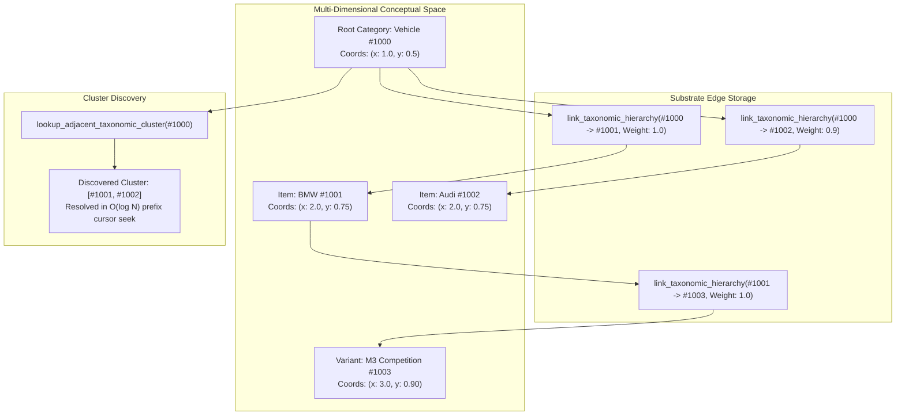

# 🕸️ Taxonomic Hierarchy & Topology Manager

> **Component:** `kernel-core/cognitives` (`topology.rs`)  
> **Underlying Subsystem:** `HypergeometricManager` over `cluaizdb-substrate` Graph Tables  
> **Reusability Level:** AI Agent Conceptual Hierarchy & Multi-Dimensional Clustering  
> **Complexity:** $O(\log N)$ root cluster seek, zero full-table scans

---

## 🧭 Architectural Flow: Hierarchical Clustering in Conceptual Space

In agent cognition, memories and knowledge are not flat strings; they exist within hierarchical taxonomic categories.

The `HypergeometricManager` bridges multi-dimensional coordinates (`DimensionCoordinates`) with graph relationships to form a navigable conceptual topology:



---

## 📐 Dimensional Coordinates & Discrete Topology Keys

Every conceptual entity can be assigned spatial coordinates within an arbitrary dimensionality space:

```rust
pub struct DimensionCoordinates {
    pub x: f64,
    pub y: f64,
}
```

- **Topology Storage**: Stored in the LMDB `records` table partitioned by `col_id`.
- **Relationship Weighting**: Edges linking parent categories to children carry relationship weights (`weight: f32`) reflecting conceptual confidence or hierarchical affinity.
- **Bi-Directional Navigation**: Agents can traverse upwards (e.g. from `BMW M3` to `Vehicle`) or downwards (e.g. from `Vehicle` to all known vehicle brands) without scanning unrelated knowledge shards.

---

## 🦀 Rust API Integration Example

```rust
use cluaizdb_cognitives::{HypergeometricManager, DimensionCoordinates};
use cluaizdb_substrate::SubstrateEnv;
use std::sync::Arc;

fn main() -> Result<(), Box<dyn std::error::Error>> {
    let db = Arc::new(SubstrateEnv::open("./data/topology_demo", 64 * 1024 * 1024)?);
    let relation_taxonomic = 1u32;
    let manager = HypergeometricManager::new(Arc::clone(&db), relation_taxonomic);

    let category_vehicle = 1000u128;
    let item_bmw = 1001u128;
    let item_audi = 1002u128;

    // 1. Assign conceptual coordinates
    manager.insert_topology_node(1, category_vehicle, DimensionCoordinates::new(1.0, 0.5))?;
    manager.insert_topology_node(1, item_bmw, DimensionCoordinates::new(2.0, 0.75))?;
    manager.insert_topology_node(1, item_audi, DimensionCoordinates::new(2.0, 0.75))?;

    // 2. Link hierarchical relationships
    manager.link_taxonomic_hierarchy(category_vehicle, item_bmw, 1.0)?;
    manager.link_taxonomic_hierarchy(category_vehicle, item_audi, 0.9)?;

    // 3. Query cluster
    let cluster = manager.lookup_adjacent_taxonomic_cluster(category_vehicle)?;
    println!("Taxonomic children: {:?}", cluster); // [1001, 1002]

    Ok(())
}
```
