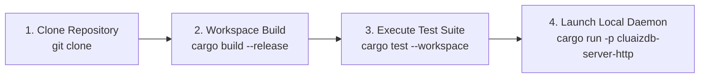

# 📦 Installation & Toolchain Requirements

This guide details how to build and install CluaizDB from source across supported platforms.

---

## 🧭 Build & Verification Pipeline



---

## 💻 System Requirements

- **Rust Toolchain**: 1.80.0 or later (MSRV)
- **Cargo**: Bundled with Rust
- **C Compiler (Optional)**: GCC, Clang, or MSVC (only required if compiling C-ABI headers via `kernel-core/ffi`)
- **Supported Operating Systems**:
  - Windows (x86_64, aarch64)
  - Linux (x86_64, aarch64)
  - macOS (x86_64, Apple Silicon M-series)

---

## 🛠️ Building from Source

Clone the repository and build the workspace:

```bash
git clone https://github.com/Cluaiz-Technologies/cluaizdb.git
cd cluaizdb

# Verify and build all workspace crates
cargo build --release

# Run comprehensive test suite across all 10 crates
cargo test --workspace
```

---

## 🚀 Running the Local Services

```bash
# Start the HTTP JSON-RPC Server on port 8080
cargo run --release -p cluaizdb-server-http

# Launch as a standalone Model Context Protocol (MCP) server
cargo run --release -p cluaizdb-server-http -- --mcp
```
