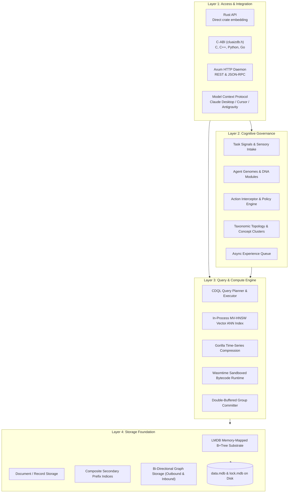

# 📖 Introduction & System Mental Model

> **Component:** `docs/get-started`  
> **Architecture:** 4-Layer Cognitive Database Subsystem  
> **Philosophy:** Embedded In-Process Multi-Model Engine for AI Agents

---

## 🧭 The 4 Core Architectural Layers

CluaizDB is designed around a clean separation of concerns, structured into 4 cohesive layers:

---

## 🧠 Mental Model Breakdown

1. **Storage Foundation (Layer 4)**:
   - Houses the persistent B+Tree tables via LMDB.
   - Provides $O(\log N)$ point lookups, bi-directional graph traversal, composite secondary indices, and zero ghost pointer cleanup.
2. **Query & Compute Engine (Layer 3)**:
   - Bridges multiple database paradigms into a unified statement via CDQL pipelines (`->`).
   - Manages in-process vector ANN search, delta-of-delta time-series compression, and sandboxed WebAssembly execution.
3. **Cognitive Governance (Layer 2)**:
   - Acts as an intelligent supervisor for AI agents.
   - Pre-evaluates tool intents and queries, blocking destructive operations and injecting bounded `< 50 token` memory context packets.
4. **Access & Integration (Layer 1)**:
   - Polyglot interfaces for any host environment: embedded Rust traits, C/Python FFI headers, Axum HTTP endpoints, or MCP tool handlers.
