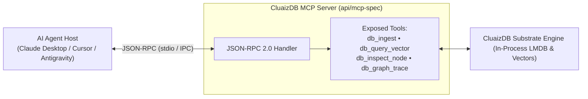

# 🔌 Model Context Protocol (MCP) Integration

This guide explains how to connect **CluaizDB** to AI Agent hosts (like Claude Desktop, Cursor, or Antigravity) using the **Model Context Protocol (MCP)**.

---

## 🧭 MCP Host to Engine Architecture



---

## 🎯 What is the CluaizDB MCP Server?

The Model Context Protocol (MCP) is an open standard allowing LLM clients to safely discover and execute database tools. CluaizDB exposes a native MCP server (`api/mcp-spec`) directly over JSON-RPC, enabling AI agents to:
1. **Durably store facts & user preferences** without stuffing the prompt context.
2. **Retrieve semantic memories** via in-process vector ANN search.
3. **Traverse relationship graphs** to understand entity connections.
4. **Seek indexed terms** across memory collections.

---

## ⚙️ 1. Configuring Claude Desktop

To use CluaizDB with Claude Desktop, edit your `claude_desktop_config.json`:

- **Windows**: `%APPDATA%\Claude\claude_desktop_config.json`
- **macOS**: `~/Library/Application Support/Claude/claude_desktop_config.json`
- **Linux**: `~/.config/Claude/claude_desktop_config.json`

Add the CluaizDB server entry:

```json
{
  "mcpServers": {
    "cluaizdb": {
      "command": "cargo",
      "args": [
        "run",
        "--release",
        "--manifest-path",
        "C:/Users/Aryan/my/Cluaiz-workspace/Cluaiz-Technologies/cluaizdb/Cargo.toml",
        "-p",
        "cluaizdb-server-http",
        "--",
        "--mcp"
      ]
    }
  }
}
```

---

## 🛠️ 2. Exposed MCP Tools

Once initialized, Claude or your agent will automatically see the following 4 tools:

### 1. `db_ingest`
Atomically records a memory or JSON document backed by group commit durability.
- **Parameters**:
  - `collection_id` (*number*): Target collection ID (default: 1).
  - `record_id` (*string*): Unique 128-bit decimal string or UUID.
  - `payload` (*string*): The JSON or text data to store.

### 2. `db_query_vector`
Finds the top-K nearest neighbors for a dense embedding vector using in-process MV-HNSW.
- **Parameters**:
  - `query` (*array of floats*): Float embedding array (e.g., `[0.12, -0.44, ...]`).
  - `k` (*integer*): Number of closest results to return (default: 5).

### 3. `db_inspect_node`
Performs an exact prefix seek on secondary index terms.
- **Parameters**:
  - `collection_id` (*number*): Collection ID.
  - `term` (*string*): Indexed term (e.g., `"user:preference"`, `"status:active"`).

### 4. `db_graph_trace`
Navigates bi-directional graph edges starting from a node.
- **Parameters**:
  - `node_id` (*string*): Starting node ID.
  - `direction` (*string*): `"outbound"` or `"inbound"` (default: `"outbound"`).
  - `type_id` (*integer*, optional): Filter by edge relationship type.
