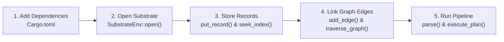

# 🚀 CluaizDB Quickstart Guide

Get up and running with CluaizDB in under 5 minutes. This guide covers embedding CluaizDB directly into your Rust project, performing core operations, and running the HTTP / CDQL query service.

---

## 🧭 Quickstart Execution Flow



---

## 📋 Prerequisites

- **Rust**: 1.80+ (Stable)
- **Cargo**: Bundled with Rust
- **Operating System**: Linux, macOS, or Windows

---

## 📦 1. Embedding CluaizDB into your Project

Add the necessary CluaizDB crates to your `Cargo.toml`:

```toml
[dependencies]
cluaizdb-substrate = { path = "kernel-core/substrate" }
cluaizdb-cdql = { path = "modules/cdql-query" }
```

---

## 💾 2. Initializing the Database Substrate

CluaizDB runs in-process via an LMDB-backed virtual memory map. No background daemons or Docker services are required:

```rust
use cluaizdb_substrate::{SubstrateEnv, StorageSubstrate};
use std::path::Path;

fn main() -> Result<(), Box<dyn std::error::Error>> {
    // Open a persistent database with a 64 MB virtual memory map allocation
    let db_path = Path::new("./data/my_agent_db");
    let map_size_bytes = 64 * 1024 * 1024; // 64 MB
    let db = SubstrateEnv::open(db_path, map_size_bytes)?;

    println!("✅ CluaizDB Substrate successfully opened!");
    Ok(())
}
```

---

## 🗂️ 3. Storing and Retrieving Records

CluaizDB organizes records into collections identified by name or numeric ID:

```rust
use cluaizdb_substrate::{SubstrateEnv, StorageSubstrate};

fn run_crud_example(db: &SubstrateEnv) -> Result<(), Box<dyn std::error::Error>> {
    // 1. Get or create a collection
    let col_id = db.get_or_create_collection("agent_memories")?;

    // 2. Insert a record (Record ID is a 128-bit integer)
    let record_id = 1001u128;
    let payload = b"{\"intent\": \"user wants weekly sales report\", \"priority\": \"high\"}";
    db.put_record(col_id, record_id, payload)?;

    // 3. Retrieve the record directly from memory map
    if let Some(data) = db.get_record(col_id, record_id)? {
        println!("Retrieved: {}", String::from_utf8_lossy(&data));
    }

    // 4. Secondary indexing (for fast term lookup)
    db.index_term(col_id, b"priority:high", record_id)?;
    let matching_ids = db.seek_index(col_id, b"priority:high")?;
    println!("Matching record IDs: {:?}", matching_ids);

    Ok(())
}
```

---

## 🕸️ 4. Graph Relationships & Traversal

CluaizDB supports native bi-directional graph edges with weights and timestamps:

```rust
use cluaizdb_substrate::{SubstrateEnv, StorageSubstrate, EdgeMetadata, TraversalConfig, TraversalDirection};

fn run_graph_example(db: &SubstrateEnv) -> Result<(), Box<dyn std::error::Error>> {
    let agent_id = 1001u128;
    let task_id = 2002u128;
    let rel_assigned = 1u32; // Edge Type ID

    let meta = EdgeMetadata {
        weight: 1.0,
        created_at: 1700000000,
        valid_until: 1800000000,
    };

    // Add Edge: agent_id -> task_id
    db.add_edge(agent_id, rel_assigned, task_id, meta)?;

    // Outbound lookup from agent
    let outbound = db.get_outbound_edges(agent_id, Some(rel_assigned))?;
    println!("Agent assigned tasks count: {}", outbound.len());

    // Reverse lookup: Who was assigned to this task? (Inbound)
    let inbound = db.get_inbound_edges(task_id, Some(rel_assigned))?;
    println!("Task assigned from agents: {:?}", inbound);

    Ok(())
}
```

---

## 📐 5. Vector Storage & ANN Indexing

Store dense vector embeddings alongside structured data:

```rust
use cluaizdb_substrate::{SubstrateEnv, StorageSubstrate};

fn run_vector_example(db: &SubstrateEnv) -> Result<(), Box<dyn std::error::Error>> {
    let col_id = db.get_or_create_collection("embeddings")?;
    let record_id = 5001u128;
    let embedding = vec![0.12f32, -0.45, 0.78, 0.22];

    // Persist raw vector into LMDB substrate
    db.put_vector(col_id, record_id, &embedding)?;

    // Read back vector
    if let Some(vec) = db.get_vector(col_id, record_id)? {
        assert_eq!(vec.len(), 4);
        println!("Vector retrieved successfully!");
    }

    Ok(())
}
```

---

## 🔍 6. Executing CDQL Queries

Query multiple data models with the unified pipeline:

```rust
use cluaizdb_cdql::{parse, build_plan, execute_plan, QueryContext};
use cluaizdb_substrate::SubstrateEnv;
use std::sync::Arc;

fn run_query_example(db: Arc<SubstrateEnv>) -> Result<(), Box<dyn std::error::Error>> {
    // CDQL Query Pipeline
    let query_str = "FIND records IN memories WHERE score > 0.8 LIMIT 10;";
    
    // Parse query into Abstract Syntax Tree
    let ast = parse(query_str)?;
    
    // Generate optimized execution plan
    let plan = build_plan(&ast)?;
    
    // Execute plan against substrate
    let mut ctx = QueryContext::new(db);
    let results = execute_plan(&plan, &mut ctx)?;

    println!("Query executed. Matched {} items.", results.records.len());
    Ok(())
}
```

---

## 🌐 7. Running the HTTP & CDQL Server

If you prefer using CluaizDB as a local microservice rather than an embedded crate:

```bash
# Start the HTTP server on port 8080
cargo run -p cluaizdb-server-http
```

You can now submit CDQL queries over HTTP:
```bash
curl -X POST http://localhost:8080/cdql \
  -H "Content-Type: application/json" \
  -d '{"query": "FIND records IN memories WHERE score > 0.8 LIMIT 10;"}'
```
