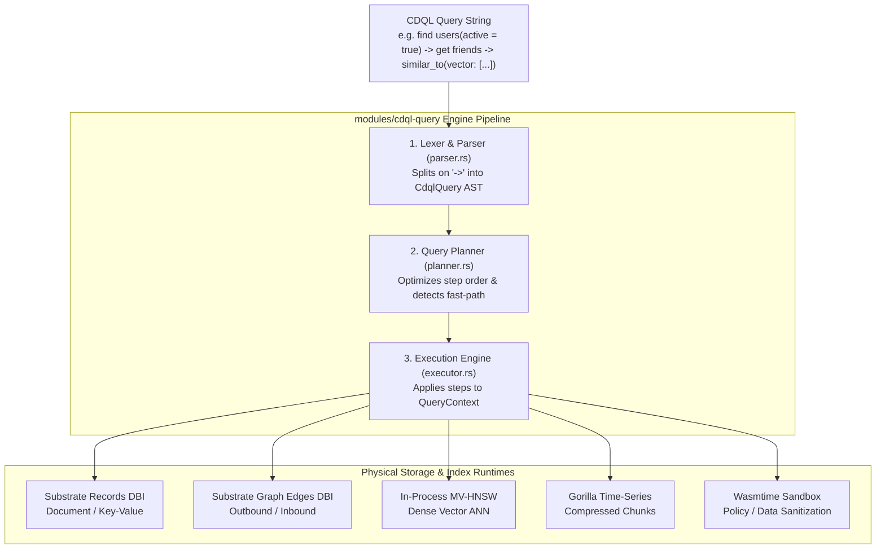
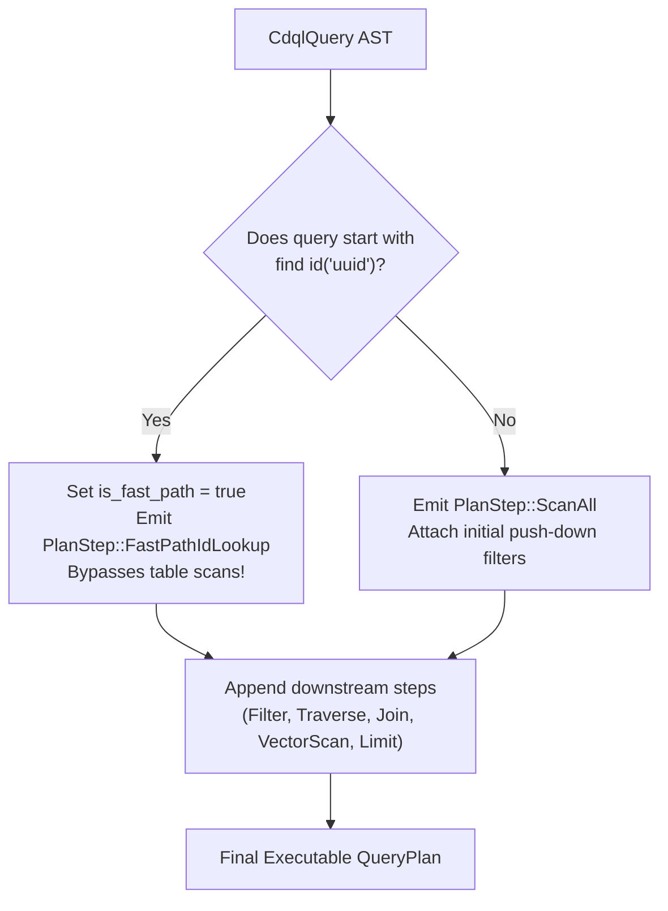

# 🔍 CDQL Architecture & Query Pipeline

> **Component:** `modules/cdql-query`  
> **Source Files:** `parser.rs`, `planner.rs`, `executor.rs`, `eval.rs`  
> **Reusability Level:** Universal Multi-Model Query Engine  
> **Runtime Complexity:** $O(\log N)$ fast-path point lookups, $O(\log N)$ HNSW vector search, linear in-memory stream filtering

---

## 🧭 The Multi-Model Synthesis Engine

In legacy architectures, an application combining structured data, relationship graphs, and AI embeddings requires three separate databases:
- **Relational DB** (PostgreSQL) for tables and transactions
- **Graph DB** (Neo4j) for edge traversals
- **Vector DB** (Qdrant/Pinecone) for embeddings

Application developers write messy glue code, serialize JSON across multiple network connections, and suffer high latency.

**CDQL (Cluaiz Database Query Language)** eliminates this friction. It unifies Key-Value, Document NoSQL, Relational Joins, Bi-directional Graphs, Vector AI, and Time-Series streams into a single in-process execution pipeline:



---

## ⚙️ Stage 1: Lexical Analysis & AST Generation (`parser.rs`)

The parser breaks the input string into sequential pipeline segments split on `->`.

### 1.1 The `CdqlOp` Abstract Syntax Tree (AST)

```rust
#[derive(Debug, Clone, PartialEq, Serialize, Deserialize)]
pub enum CdqlOp {
    // Ingestion
    Insert { label: String, data: HashMap<String, CdqlValue> },
    
    // Selectors
    Find { label: String, filters: Vec<Filter> },
    FindById { id: String },
    
    // In-Memory Transformers
    Filter { field: String, op: CompareOp, value: CdqlValue },
    Project { keep: Vec<String> },
    Unwind { field: String },
    Limit(usize),
    SortBy { field: String, ascending: bool },
    
    // Graph
    Traverse { edge: String, min_hops: usize, max_hops: usize, min_weight: f64 },
    ShortestPath { to_node: String },
    
    // Relational
    Join { target: String, on_left: String, on_right: String, join_type: JoinType },
    GroupBy { fields: Vec<String> },
    Aggregate { functions: Vec<AggFunc> },
    
    // Multi-Model Modifiers
    TimeWindow { size: String },
    SimilarTo { vector: Vec<f32>, metric: String },
    Search { query: String, fuzzy: bool },
    GeoNear { lat: f64, lon: f64, radius_km: f64 },
    RangeScan { field: String, start: CdqlValue, end: CdqlValue },
    Stream { start_byte: usize, end_byte: usize },
    
    // WebAssembly
    WasmTransform { genome_id: u64, func: String },
}
```

---

## ⚡ Stage 2: Query Optimization & Planning (`planner.rs`)

The planner converts the AST into an ordered `QueryPlan` consisting of `PlanStep` instructions.



### The Fast-Path Optimization
When an agent queries by ID (`find id("1001")`), scanning millions of records is wasteful. The planner detects this immediately:
- Sets `is_fast_path = true`.
- Emits `PlanStep::FastPathIdLookup { id: "1001" }`.
- Execution performs a single B+Tree cursor seek directly into the LMDB `records` table in $O(\log N)$ time.

---

## 🚀 Stage 3: In-Process Execution Engine (`executor.rs`)

The executor receives the `QueryPlan` and runs it against a mutable `QueryContext`:

```rust
pub struct QueryContext {
    pub db: Arc<SubstrateEnv>,
    pub vector_index: Option<Arc<HnswIndex<CosineDistance>>>,
}
```

### Execution Loop Lifecycle:
1. **Initial Population**: Either resolves the single fast-path ID or scans collection records in LMDB matching initial pushdown filters.
2. **Sequential Step Application**:
   - `PlanStep::GraphTraverse`: For every record in the current working set, queries `outbound_edges` table in the substrate, collecting adjacent target IDs.
   - `PlanStep::VectorScan`: Passes vectors to the in-process `HnswIndex` graph, collecting top-K candidates.
   - `PlanStep::RelationalJoin`: Performs an in-memory hash join against the target collection.
   - `PlanStep::FilterResults`: Evaluates expressions against payload JSON fields.
3. **Result Materialization**:
   Returns a `QueryResult` containing matched records, vectors, and execution metadata.

---

## 🦀 Embedding CDQL Execution in Rust

```rust
use cluaizdb_cdql::{parse, build_plan, execute_plan, QueryContext};
use cluaizdb_substrate::SubstrateEnv;
use std::sync::Arc;

fn main() -> Result<(), Box<dyn std::error::Error>> {
    let db = Arc::new(SubstrateEnv::open("./data/agent_db", 64 * 1024 * 1024)?);
    
    // 1. Parse CDQL
    let query_str = "find users(status = \"active\") -> get friend -> limit 10";
    let ast = parse(query_str)?;
    
    // 2. Generate Plan
    let plan = build_plan(&ast)?;
    println!("Fast path enabled: {}", plan.is_fast_path);
    
    // 3. Execute against Substrate
    let mut ctx = QueryContext::new(Arc::clone(&db));
    let result = execute_plan(&plan, &mut ctx)?;
    
    for record in result.records {
        println!("Matched ID: {}, Payload: {}", record.id, String::from_utf8_lossy(&record.data));
    }
    
    Ok(())
}
```

---

## 🛡️ Invariants & Failure Modes

- **Zero Network Latency**: All CDQL pipeline steps execute within the caller thread memory space. There are zero socket roundtrips between query steps.
- **Graceful Error Handling**: Syntax errors return `Err(String)` at parse time before touching physical storage.
- **Resource Protection**: Unbounded traversals are capped by `TraversalConfig::limit` and explicit `-> limit <N>` pipeline steps.
