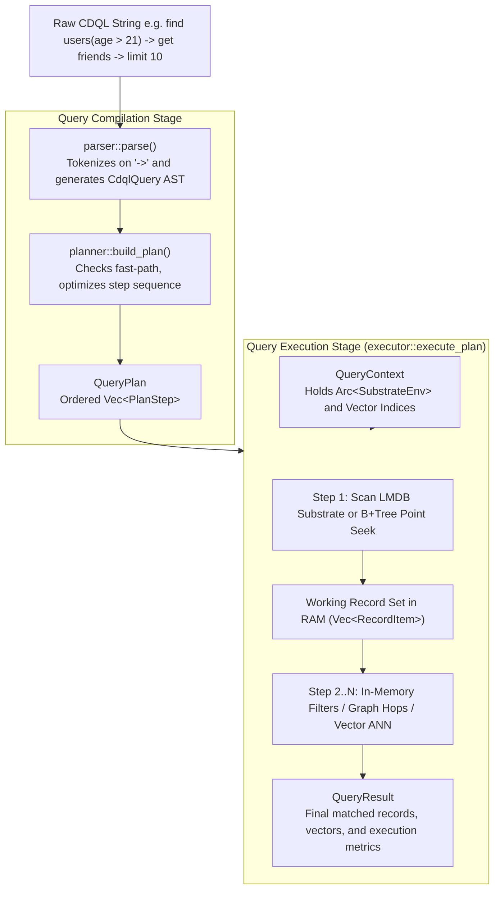
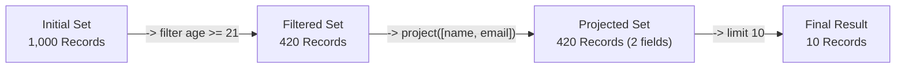
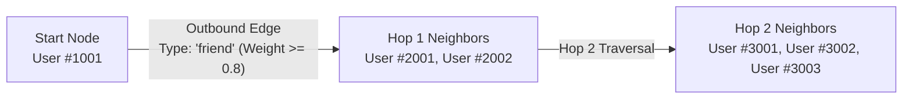
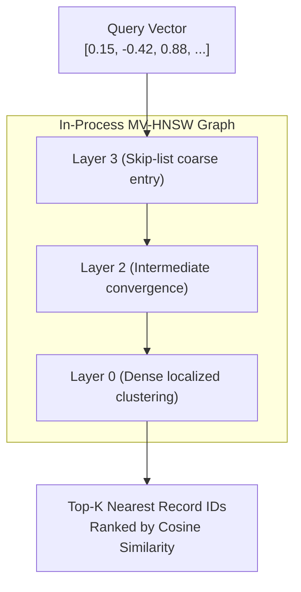

# 📜 CDQL Syntax & Operators — Complete Technical Blueprint

> **Component:** `modules/cdql-query`  
> **Interface:** Parser (`parser.rs`), Planner (`planner.rs`), Executor (`executor.rs`)  
> **Reusability Level:** Universal Multi-Model Query Engine  
> **Runtime Complexity:** $O(\log N)$ point lookups, $O(\log N)$ HNSW vector search, linear in-memory stream filtering

---

## 🧭 Architectural Flow: How a CDQL Pipeline Executes

Every CDQL query is a directed pipeline where data flows through distinct compilation and execution stages inside the same Rust process:



---

## 🗂️ 1. Root Selectors (Query Entrypoints)

Every CDQL pipeline must begin with a **Root Selector** (`find` or `insert`) that initializes the working record set.

### 1.1 `find id("<uuid_or_numeric_id>")` — Fast-Path Point Seek ⚡
- **Mechanism**: The planner flags `is_fast_path = true`. It completely bypasses table iterations and executes a direct $O(\log N)$ point seek in the LMDB `records` B+Tree table using the 128-bit decoded record ID.
- **When to use**: Any time the exact record ID is known.
```text
find id("1001")
```
- **Execution Trace**:
  ```text
  Input:  id("1001")
  Action: SubstrateEnv::get_record(col_id, 1001)
  Result: 1 record in working set (or empty set if not found)
  ```

---

### 1.2 `find <collection>(<filters>)` — Filtered Scan
- **Mechanism**: Scans records belonging to the target collection in the substrate, evaluating key-value filter conditions against payload JSON data.
- **Syntax**:
```text
find users(status = "active", role = "admin")
find memories(priority >= 0.8)
find telemetry(temperature > 75.5)
```
- **Filter Operators Supported**:
  - `=` (Equality)
  - `!=` (Inequality)
  - `>` (Strictly Greater Than)
  - `<` (Strictly Less Than)
  - `>=` (Greater Than or Equal)
  - `<=` (Less Than or Equal)
  - `contains` (Substring match or array membership)

---

### 1.3 `find *` — Wildcard Collection Scan
- **Mechanism**: Scans across all records in the active database partition.
```text
find * -> filter active = true -> limit 50
```

---

### 1.4 `insert <collection> { <json_payload> }` — Data Ingestion
- **Mechanism**: Serializes the provided key-value dictionary and writes it to the collection via `SubstrateEnv::put_record`.
```text
insert users {"name": "Alice", "role": "admin", "credits": 500}
```

---

## 🔗 2. Transformation & Filtering Operators

Once the root selector populates the initial working set, operators are chained using the `->` pipeline arrow.



### 2.1 `filter <field> <op> <value>`
Applies in-memory condition checks to narrow down candidate records:
```text
-> filter age >= 21
-> filter tier = "gold"
-> filter tags contains "verified"
```

### 2.2 `project([field1, field2, ...])`
Discards all fields except the specified list, drastically reducing memory usage:
```text
-> project([user_id, email, created_at])
```

### 2.3 `unwind("<array_field>")`
Explodes an array field into individual records (one per element):
```text
-> unwind("skills")
```

### 2.4 `limit <count>`
Caps the maximum number of records processed or returned:
```text
-> limit 20
```

### 2.5 `sort_by(field: "<name>", asc: <bool>)`
Orders the working set in-memory by a numeric or string attribute:
```text
-> sort_by(field: "score", asc: false)
```

---

## 🕸️ 3. Graph Operations (Relationship Traversal)

CluaizDB unifies graph relationships directly with record attributes via the LMDB `outbound_edges` and `inbound_edges` tables.



### 3.1 `get <edge_type>` — Single-Hop Traversal
Follows outgoing relationships of the specified edge type from all nodes currently in the working set:
```text
find id("1001") -> get friend -> filter status = "active"
```

### 3.2 `traverse(edge: "<name>", min_hops: 1, max_hops: 3, min_weight: 0.5)`
Executes a multi-hop Breadth-First Search (BFS) graph exploration:
```text
find id("1001") -> traverse(edge: "knows", min_hops: 1, max_hops: 3, min_weight: 0.7) -> limit 50
```
- `edge`: Relationship label filter (omit or use `*` for all edge types).
- `min_hops` / `max_hops`: Depth boundary for BFS expansion.
- `min_weight`: Minimum threshold for edge weights (0.0 to 1.0).

### 3.3 `shortest_path("<target_node_id>")`
Finds the lowest-weight connection path using Dijkstra's algorithm over the graph:
```text
find id("1001") -> shortest_path("9009")
```

---

## 📐 4. In-Process Vector AI Operations

Vectors are queried in-process via `modules/index-engine/mvhsnw-vector` without external network roundtrips.



### 4.1 `similar_to(vector: [<floats>], metric: "<cosine|l2>")`
Executes an Approximate Nearest Neighbor search:
```text
find memories -> similar_to(vector: [0.12, -0.45, 0.78], metric: "cosine") -> limit 5
```
- **`metric: "cosine"`**: Angular distance for semantic text embeddings.
- **`metric: "l2"`**: Euclidean distance for spatial coordinates and sensor patterns.

---

## 🗄️ 5. Relational Joins & SQL Aggregations

### 5.1 `join(target: "<collection>", on_left: "<field>", on_right: "<field>", type: "<inner|left|right|full>")`
Performs an in-memory hash join between two collections:
```text
find orders(status = "completed") -> join(target: "users", on_left: "customer_id", on_right: "id", type: "inner") -> project([order_id, name, total])
```

### 5.2 `group_by("<field1>", "<field2>")` & `aggregate(...)`
Groups records and computes statistical metrics:
```text
find transactions -> group_by("department") -> aggregate(count(), sum("amount"), avg("tax"))
```
**Supported Aggregation Functions**:
- `count()`: Total rows in bucket.
- `sum("<field>")`: Sum of numeric values.
- `avg("<field>")`: Arithmetic mean.
- `min("<field>")`: Minimum value.
- `max("<field>")`: Maximum value.

---

## ⏱️ 6. Time-Series Windowing & Range Scans

### 6.1 `time_window(size: "<window_duration>")`
Groups chronological events into buckets for trend analysis:
```text
find server_metrics -> time_window(size: "5m") -> aggregate(avg("cpu_usage"), max("memory_mb"))
```

### 6.2 `range(field: "<name>", start: <v>, end: <v>)`
Executes a numeric or timestamp range seek:
```text
find events -> range(field: "timestamp", start: 1700000000, end: 1700003600)
```

---

## 🔒 7. Sandboxed WebAssembly Execution

### `wasm(genome_id: <u64>, func: "<entrypoint>")`
Runs compiled WebAssembly bytecode via `runtimes/wasmtime-sandbox` with hard linear memory boundaries and fuel metering:
```text
find raw_logs -> wasm(genome_id: 101, func: "sanitize_pii") -> limit 100
```

---

## 🏆 The 4 Core Hybrid Synthesis Patterns

Real-world AI and database workloads require combining multiple paradigms in a single statement.

### Pattern 1: Graph Traversal + Vector Semantic Ranking
**Scenario**: Recommend items purchased by friends that match the user's semantic interest:
```text
find id("user_1001") -> get friends -> traverse(edge: "purchased", max_hops: 1) -> similar_to(vector: [0.33, -0.12, 0.85], metric: "cosine") -> limit 10
```

### Pattern 2: E-Commerce Relational Join + Financial Filter
**Scenario**: Match high-value completed orders with user profiles:
```text
find orders(status = "completed") -> filter amount > 5000 -> join(target: "users", on_left: "user_id", on_right: "id", type: "inner") -> project([order_id, user_id, email, amount])
```

### Pattern 3: Time-Series Windowing + Aggregation
**Scenario**: Calculate 1-hour average CPU load per cluster:
```text
find metrics(service = "payment_gateway") -> time_window(size: "1h") -> aggregate(avg("cpu"), max("latency_ms"))
```

### Pattern 4: Full-Text Search + Geospatial Proximity
**Scenario**: Find highly rated restaurants within a 5km radius matching a keyword:
```text
find restaurants(rating >= 4.5) -> geo_near(lat: 37.7749, lon: -122.4194, radius_km: 5.0) -> search(query: "sushi", fuzzy: true) -> limit 5
```

---

## ⚠️ Failure Modes & Error Recovery

| Failure Condition | Engine Behavior | Recovery Strategy |
| :--- | :--- | :--- |
| **Malformed CDQL Syntax** | `parser::parse` returns `Err("Expected 'find' or 'insert'...")` | Inspect query string; ensure pipelines start with `find` or `insert`. |
| **Non-Existent Collection** | Executor returns empty result set or creates collection on write | Verify collection name with `db.list_collections()`. |
| **Vector Dimension Mismatch** | ANN index returns empty or error if vector length does not match index dimension | Verify embedding model output dimension matches index initialization. |
| **Wasm Fuel Exhaustion** | Runtime traps with `SandboxError::OutOfFuel` | Increase `fuel_limit` in `SandboxConfig` or optimize plugin loop logic. |
