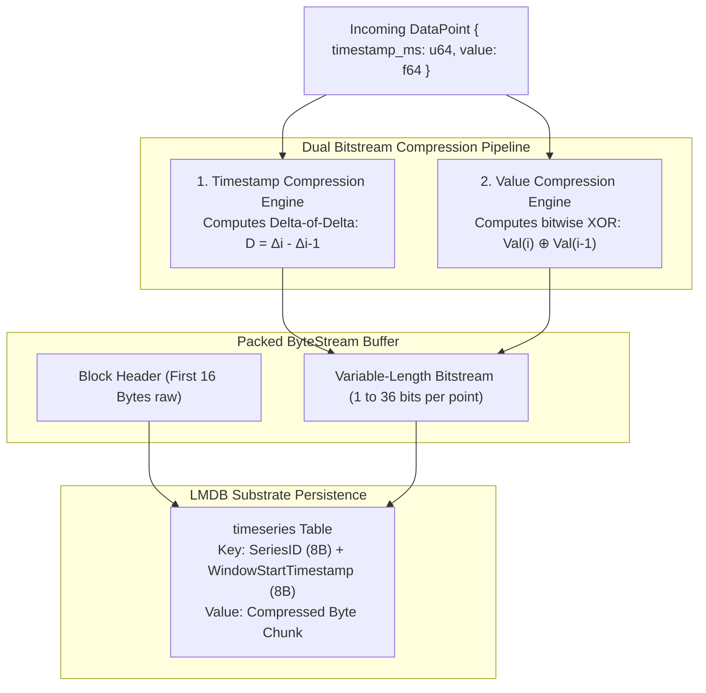

# ⏱️ Gorilla Time-Series Compression Architecture

> **Component:** `modules/time-series` (`gorilla.rs`)  
> **Algorithm:** Facebook Gorilla Time-Series Protocol  
> **Reusability Level:** High-Frequency Metric Stream & Event Telemetry Storage  
> **Compression Profile:** ~10x to 12x storage reduction over uncompressed 64-bit timestamps and floats

---

## 🧭 Architectural Flow: The Dual Compression Pipeline

Storing uncompressed sensor streams, latency logs, and agent telemetry at 16 bytes per entry (8 bytes for `u64` timestamp + 8 bytes for `f64` value) quickly exhausts RAM and disk bandwidth.

The Gorilla compression protocol processes incoming data points through two independent bitstream compression engines:



---

## 🔢 1. Timestamp Delta-of-Delta Compression Specification

Most metrics arrive on a regular heartbeat (e.g., every 1,000ms). The difference between consecutive deltas ($D = \Delta_i - \Delta_{i-1}$) is frequently zero:

$$D = (t_i - t_{i-1}) - (t_{i-1} - t_{i-2})$$

### Variable-Length Bit Encoding:

```mermaid
flowchart TD
    CALC["Compute Delta-of-Delta (D)"] --> CHECK_ZERO{"Is D == 0?"}
    
    CHECK_ZERO -->|Yes (Common Case)| BIT_ZERO["Store 1 bit: '0'<br/>(Optimal periodic compression)"]
    CHECK_ZERO -->|No| CHECK_SMALL{"Is -63 &lt;= D &lt;= 64?"}
    
    CHECK_SMALL -->|Yes| BITS_7["Store prefix '10' + 7 bits (9 bits total)"]
    CHECK_SMALL -->|No| CHECK_MED{"Is -255 &lt;= D &lt;= 256?"}
    
    CHECK_MED -->|Yes| BITS_9["Store prefix '110' + 9 bits (12 bits total)"]
    CHECK_MED -->|No| CHECK_LARGE{"Is -2047 &lt;= D &lt;= 2048?"}
    
    CHECK_LARGE -->|Yes| BITS_12["Store prefix '1110' + 12 bits (16 bits total)"]
    CHECK_LARGE -->|No| BITS_32["Store prefix '1111' + 32 bits (36 bits total)"]
```

For periodic systems, each subsequent timestamp requires **only 1 bit** instead of 64 bits.

---

## 🧮 2. Floating-Point Value XOR Compression Specification

Consecutive 64-bit IEEE 754 floating-point numbers often share identical exponent and high mantissa bits. Gorilla computes the bitwise XOR:

$$\text{XOR} = \text{bits}(v_i) \oplus \text{bits}(v_{i-1})$$

1. **Case 1: XOR is 0 (Value unchanged)**
   - Stored as a single `0` bit.
2. **Case 2: XOR is non-zero (Value changed)**
   - Preceded by a `1` bit.
   - If leading and trailing zero boundaries match the previous value:
     - Stored as control bits `0` followed only by the variable meaningful bits.
   - If boundaries change:
     - Stored as control bits `1`, followed by 5 bits (leading zero count), 6 bits (meaningful bit length), and the meaningful bits.

---

## 💾 Range Scanning in LMDB Substrate

Chunks are persisted into the LMDB `timeseries` table:
- **Key**: `SeriesID (8 bytes BE) + WindowStartTime (8 bytes BE)`.
- **Querying**: `scan_timeseries_chunks(series_id, start_ts, end_ts)` scans contiguous keys in the B+Tree using an LMDB cursor, decompressing only the chunks that intersect the requested time window.
