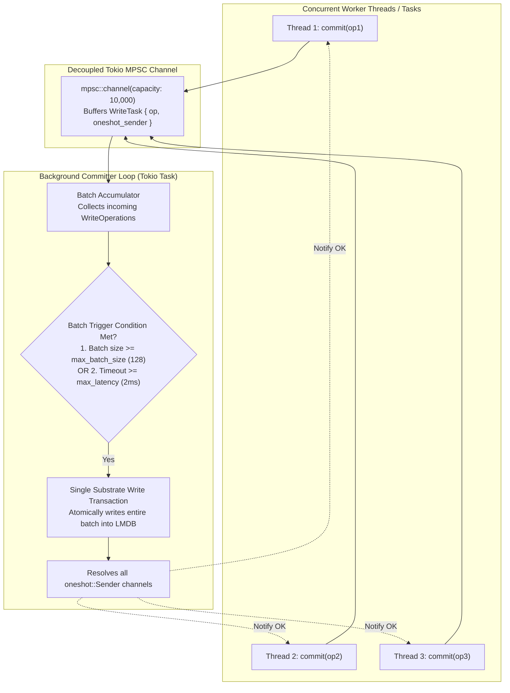
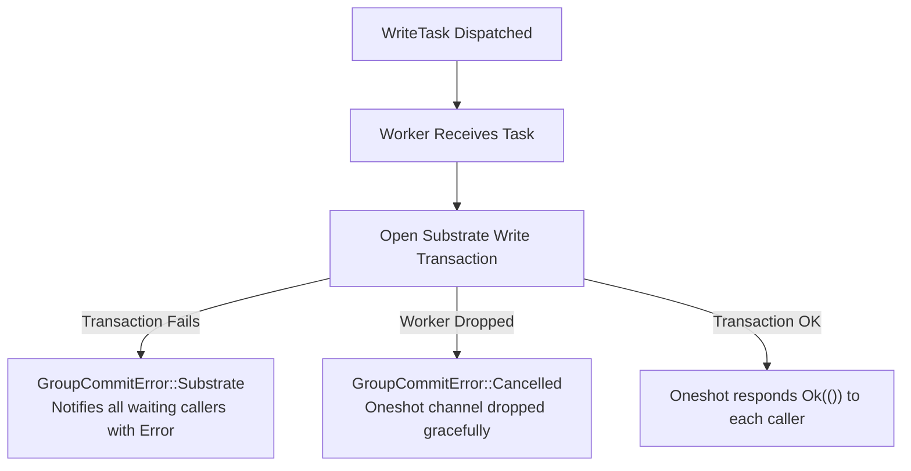

# 💾 Double-Buffered Group Commit Pipeline

> **Component:** `modules/group-commit` (`lib.rs`)  
> **Reusability Level:** High-Throughput Durable Write Coordination  
> **Throughput Model:** Decoupled In-Memory MPSC Queue with Tokio Worker Batching

---

## 🧭 Architectural Flow: Decoupled Batch Commit

Under heavy concurrent write workloads, performing synchronous disk syncs (`fsync`) for every single insertion causes severe I/O stalls.

The `GroupCommitter` decouples caller write dispatching from physical disk commits:



---

## ⚙️ Configuration & Batch Trigger Rules

The batching behavior is governed by `GroupCommitConfig`:

```rust
pub struct GroupCommitConfig {
    pub max_batch_size: usize,      // Default: 128 operations
    pub max_latency: Duration,      // Default: 2 milliseconds
    pub channel_capacity: usize,    // Default: 10,000 tasks
}
```

### The Dual Trigger Condition:
1. **Size Trigger (`max_batch_size = 128`)**:
   - If a burst of write operations arrives, the batch commits immediately upon reaching 128 items, maximizing throughput without unnecessary delays.
2. **Time-Limit Trigger (`max_latency = 2ms`)**:
   - Under low traffic, operations are never delayed indefinitely. If fewer than 128 items arrive, the worker flushes the batch as soon as the 2ms timer fires.

---

## 🛡️ Failure Modes & Recovery Guarantees



- **Thread Safety**: `GroupCommitter` derives `Clone` and can be passed across arbitrary threads and async tasks.
- **Graceful Error Bubbling**: If an LMDB disk quota is reached or I/O fails, the error bubbles back to every caller via their respective `oneshot::Receiver`.
- **Channel Saturation Defense**: If the channel exceeds `channel_capacity`, caller dispatches fail with `GroupCommitError::ChannelSend`, preventing unbounded RAM consumption.
