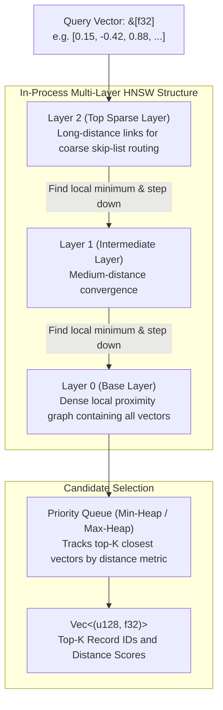
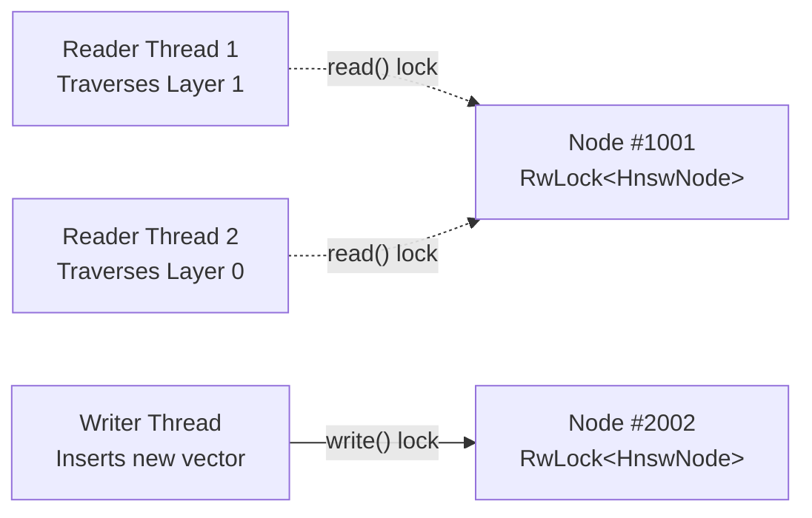

# 📐 Multi-View Vector Index (MV-HNSW)

> **Component:** `modules/index-engine/mvhsnw-vector`  
> **Source Files:** `graph.rs`, `node.rs`, `distance.rs`  
> **Reusability Level:** In-Process Approximate Nearest Neighbor (ANN) Search  
> **Complexity:** $O(\log N)$ layered graph search, per-node `RwLock` concurrency

---

## 🧭 Architectural Flow: Hierarchical Small World Routing

External vector databases (Pinecone, Milvus, Qdrant) incur network roundtrips and JSON serialization overhead. CluaizDB embeds the vector index graph directly inside the application process memory space.

When a query vector is submitted, the search executes across multiple hierarchical layers:



---

## 📏 Distance Metrics Specification

The index implements the `DistanceMetric` trait in `distance.rs`:

```rust
pub trait DistanceMetric: Send + Sync {
    fn distance(a: &[f32], b: &[f32]) -> f32;
}
```

### 1. `CosineDistance` (Semantic Text Embeddings)
Measures angular divergence between two vectors regardless of magnitude:
$$\text{dist}(u, v) = 1.0 - \frac{\sum_{i=1}^D u_i v_i}{\sqrt{\sum_{i=1}^D u_i^2} \cdot \sqrt{\sum_{i=1}^D v_i^2}}$$
- **Range**: `0.0` (Identical direction) to `2.0` (Opposite direction).
- **Ideal for**: Text embeddings from OpenAI, SentenceTransformers, BGE, and Cohere.

### 2. `L2Distance` (Euclidean Distance)
Measures straight-line geometric distance across coordinates:
$$\text{dist}(u, v) = \sqrt{\sum_{i=1}^D (u_i - v_i)^2}$$
- **Range**: `0.0` to $\infty$.
- **Ideal for**: Spatial projections, unnormalized telemetry, and sensor clusters.

---

## 🔒 Concurrency & Per-Node Locking



- **Fine-Grained `RwLock`**: Each graph node (`HnswNode`) encapsulates its adjacency links in an independent `parking_lot::RwLock`.
- **Lock-Free Global Routing**: Readers traversing disparate branches of the graph never contend for a single global mutex.
- **Concurrent Insertion**: New nodes can be inserted concurrently by multiple worker threads while background searches are executing.

---

## 🔄 Rehydration from Durable Substrate

The HNSW graph is memory-resident for high search performance, while raw vectors are persisted in the LMDB `vectors` table.

On process boot, `rehydrate_hnsw_from_substrate(db, col_id)` iterates through the durable vectors DBI and populates the in-memory HNSW index without reading any raw JSON documents:

```rust
use cluaizdb_cdql::rehydrate_hnsw_from_substrate;
use cluaizdb_index_mvhsnw::{CosineDistance, HnswIndex};
use std::sync::Arc;

let vector_index = Arc::new(HnswIndex::<CosineDistance>::new());
let loaded_count = rehydrate_hnsw_from_substrate(&db, col_id, &vector_index)?;
println!("Rehydrated {} vectors into in-memory HNSW graph.", loaded_count);
```
