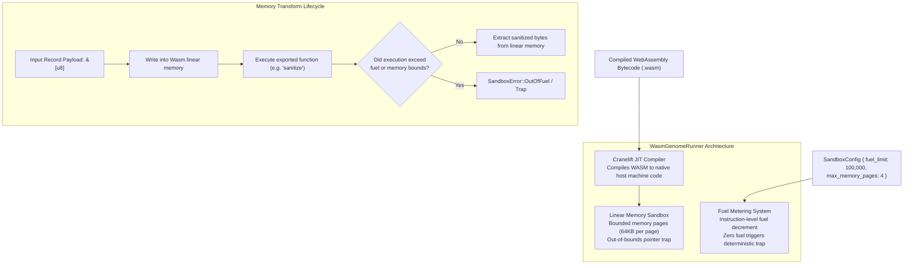

# 🔒 Wasmtime Sandboxing & Fuel Metering

> **Component:** `runtimes/wasmtime-sandbox` (`runner.rs`, `config.rs`)  
> **Underlying Engine:** Bytecode Alliance Wasmtime with Cranelift JIT  
> **Reusability Level:** Sandboxed User-Defined Policy Execution & Data Validation  
> **Security Boundaries:** Linear Memory Isolation + Epoch/Instruction Fuel Metering

---

## 🧭 Architectural Flow: Secure In-Process Sandboxing

Running user policies or agent transformations inside a database process without protection risks server crashes or denial-of-service (DoS) via infinite loops.

CluaizDB embeds **Wasmtime**, compiling WebAssembly bytecode directly into native machine code while enforcing hard CPU and memory sandboxes:



---

## 🔒 The Three Sandbox Invariants

### 1. Hard Linear Memory Boundaries
- Each instance executes within an isolated linear memory buffer.
- Pointer addresses outside the allocated `max_memory_pages` boundary cannot access host memory or database internals.
- Violations trigger an immediate deterministic WebAssembly trap, leaving the database host unharmed.

### 2. Fuel Metering (Anti-Infinite Loop Protection)
- Every executed WebAssembly instruction decrements an internal fuel counter from `fuel_limit`.
- If an agent plugin enters an infinite loop (`loop { ... }`) or consumes excessive CPU cycles, the fuel counter hits zero and halts execution with `SandboxError::OutOfFuel`.
- Host worker threads never hang or starve.

### 3. Cranelift JIT Native Performance
- Rather than running through an interpreted script engine, Wasmtime JIT-compiles bytecode into native CPU instructions on the first load.
- Sandboxed plugins execute at near-native speed.

---

## 🦀 Rust API Execution Example

```rust
use cluaizdb_wasm_sandbox::{WasmGenomeRunner, SandboxConfig, SandboxError};

fn execute_sandbox_transform(wasm_bytes: &[u8], payload: &[u8]) -> Result<Vec<u8>, Box<dyn std::error::Error>> {
    // 1. Configure strict boundaries: 100,000 fuel units, 4 pages (256 KB RAM)
    let config = SandboxConfig::new(100_000, 4);
    let runner = WasmGenomeRunner::new(config)?;

    // 2. Compile module to machine code
    let module = runner.compile(wasm_bytes)?;

    // 3. Execute memory transformation
    match runner.execute_memory_transform(&module, "sanitize_payload", payload) {
        Ok(clean_data) => Ok(clean_data),
        Err(SandboxError::OutOfFuel) => {
            eprintln!("Plugin exceeded allocated CPU fuel budget!");
            Err("Fuel exhausted".into())
        }
        Err(e) => Err(e.into()),
    }
}
```
