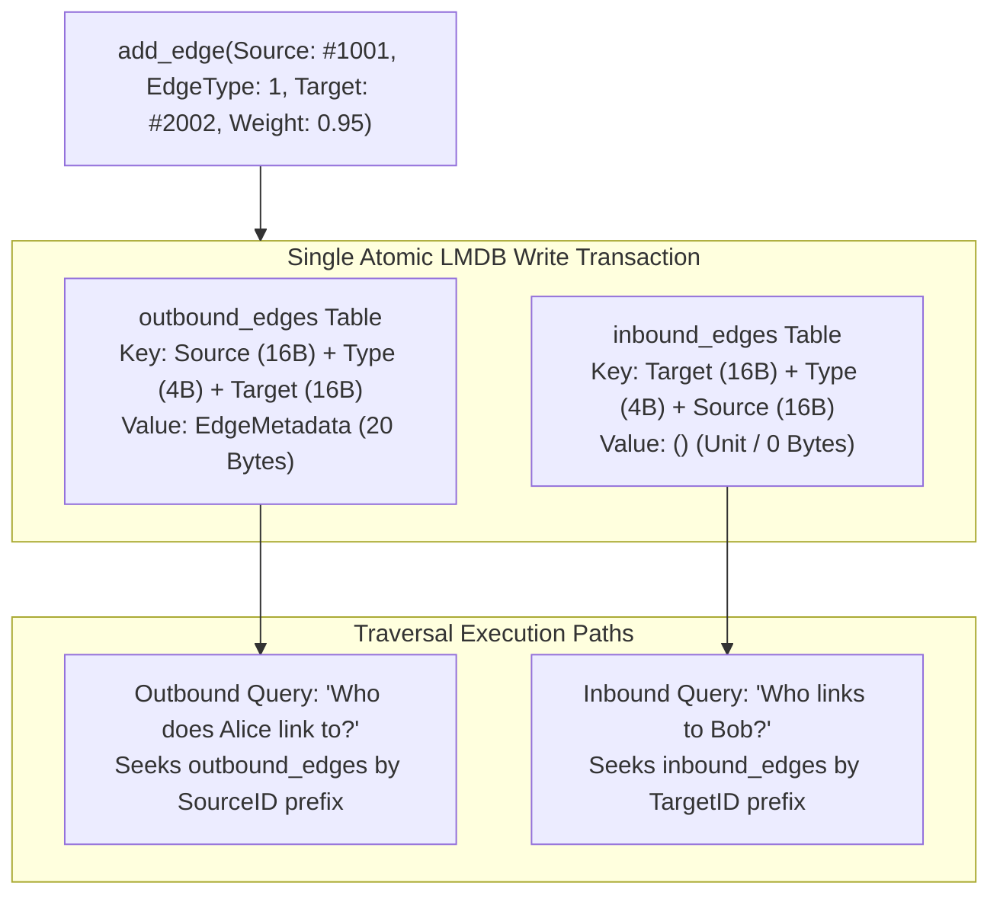
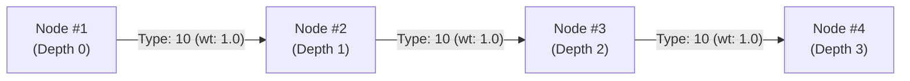

# 🔗 Bi-Directional Graph Storage & Traversal Engine

> **Component:** `kernel-core/substrate` (`graph.rs`, `schema.rs`)  
> **Underlying Tables:** `outbound_edges` (Data + Weight), `inbound_edges` (Index-Free Unit)  
> **Reusability Level:** Core Storage & Multi-Hop Relationship Subsystem  
> **Complexity:** $O(\log N)$ root cursor seek + $O(K)$ edge sequential iteration, zero full-table scans

---

## 🧭 Architectural Flow: Dual-Table Indexing & Adjacency Navigation

In graph database operations, traversing forward (outbound) is straightforward, but querying incoming connections (inbound) typically requires scanning the entire edge table unless an inverted index is maintained.

CluaizDB solves this at the storage level by writing to **two complementary B+Tree tables** atomically:



---

## 🗃️ Binary Key Layout & Edge Metadata Specification

### 1. `outbound_edges` Table
- **Key (36 Bytes, Big-Endian)**:
  ```text
  [0..16]   SourceNodeID (u128)
  [16..20]  EdgeTypeID   (u32)
  [20..36]  TargetNodeID (u128)
  ```
- **Value (`EdgeMetadata`, 20 Bytes)**:
  ```text
  [0..4]    weight       (f32, IEEE 754 Big-Endian)
  [4..12]   created_at   (u64, Timestamp Unix Milliseconds)
  [12..20]  valid_until  (u64, Expiration Unix Milliseconds)
  ```

### 2. `inbound_edges` Table
- **Key (36 Bytes, Big-Endian)**:
  ```text
  [0..16]   TargetNodeID (u128)
  [16..20]  EdgeTypeID   (u32)
  [20..36]  SourceNodeID (u128)
  ```
- **Value**: Empty `()` (0 bytes).

### Why this design eliminates table scans:
- Both forward and reverse queries are **exact prefix seeks** in the B+Tree.
- To find all entities pointing to Node `#2002`, the cursor seeks directly to key prefix `#2002 (16 bytes)` in `inbound_edges`.
- Complexity is $O(\log N)$ for the initial seek plus $O(K)$ sequential page reads for the $K$ adjacent edges.

---

## 🚶 Multi-Hop Traversal Algorithms

The graph engine implements two core traversal algorithms in `graph.rs`:



### 1. Breadth-First Search (BFS) Multi-Hop (`traverse_graph`)

```rust
pub struct TraversalConfig {
    pub max_depth: usize,               // Maximum hops from root (e.g. 3)
    pub min_weight: f32,                // Prunes edges weaker than threshold
    pub limit: usize,                   // Maximum visited nodes
    pub edge_type: Option<u32>,         // Specific edge type filter
    pub direction: TraversalDirection,  // Outbound, Inbound, or Both
}
```

- Uses a `VecDeque` for level-by-level breadth exploration.
- Tracks a `HashSet<u128>` to detect and break cyclical loops.
- Returns a list of `TraversalNode` instances:
  ```rust
  pub struct TraversalNode {
      pub node_id: u128,
      pub depth: usize,
      pub cumulative_weight: f32,
  }
  ```

---

### 2. Dijkstra's Shortest Path (`find_shortest_path`)

Finds the lowest-cost path between two entities using an internal min-heap priority queue (`BinaryHeap<DijkstraState>`):

```rust
let path: Option<Vec<u128>> = db.find_shortest_path(start_id, target_id, &config)?;
// Example Output: Some([1001, 1002, 1003, 1004])
```

- **Cost Function**: Evaluates reciprocal weight sums ($1.0 / \text{weight}$) to prioritize strong relationships.
- **Path Reconstruction**: Employs an internal predecessor map (`HashMap<u128, u128>`) to retrace the exact path upon target convergence.

---

## 🦀 Rust API Integration Example

```rust
use cluaizdb_substrate::{
    SubstrateEnv, StorageSubstrate, EdgeMetadata,
    TraversalConfig, TraversalDirection
};

fn main() -> Result<(), Box<dyn std::error::Error>> {
    let db = SubstrateEnv::open("./data/graph_demo", 64 * 1024 * 1024)?;

    let alice = 1001u128;
    let bob = 2002u128;
    let charlie = 3003u128;
    let rel_colleague = 1u32;

    let meta = EdgeMetadata { weight: 0.95, created_at: 1700000000, valid_until: 1800000000 };

    // Add edges: Alice -> Bob, Bob -> Charlie
    db.add_edge(alice, rel_colleague, bob, meta)?;
    db.add_edge(bob, rel_colleague, charlie, meta)?;

    // Multi-hop outbound traversal from Alice
    let config = TraversalConfig {
        max_depth: 2,
        min_weight: 0.5,
        limit: 100,
        edge_type: Some(rel_colleague),
        direction: TraversalDirection::Outbound,
    };

    let discovered = db.traverse_graph(alice, &config)?;
    for node in discovered {
        println!("Visited node: {} at depth {}", node.node_id, node.depth);
    }

    // Inbound reverse check on Charlie
    let who_points_to_charlie = db.get_inbound_edges(charlie, Some(rel_colleague))?;
    println!("Inbound parents: {:?}", who_points_to_charlie); // Prints [bob]

    Ok(())
}
```
