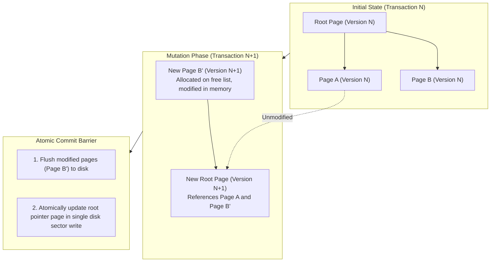

# 💿 Disk Persistence & ACID Crash Durability

> **Component:** `kernel-core/substrate` (`db.rs`)  
> **Underlying Files:** `data.mdb` (Main DB), `lock.mdb` (Lock Table)  
> **Durability Model:** Copy-on-Write (CoW) B+Tree with Atomic Sector Root Flush  
> **Crash Recovery:** Zero WAL Replay, Instant Crash Resilience

---

## 🧭 Architectural Flow: Copy-on-Write (CoW) Disk Persistence

Unlike traditional databases that overwrite existing pages in-place and rely on complex Write-Ahead Log (WAL) replay to recover from crashes, LMDB utilizes a **Copy-on-Write (CoW)** B+Tree architecture:



---

## 🔒 Why CluaizDB Eliminates WAL Replay

1. **Immutable In-Flight Pages**:
   - In-flight write transactions never modify existing pages that active readers are inspecting.
   - Updates are written to brand new pages allocated from an internal free list.
2. **Atomic Single-Sector Switch**:
   - The entire transaction becomes committed in a single disk sector write that updates the root pointer page.
3. **Instant Crash Recovery**:
   - If power is lost before the root pointer updates, the database simply boots from Version $N$ on the next restart.
   - Zero corrupted pages, zero dirty reads, and zero WAL replay recovery delay.

---

## 📁 File Structure on Disk

```text
data/cluaizdb/
├── 📄 data.mdb   # Main B+Tree data file containing all 9 tables
└── 📄 lock.mdb   # Reader lock table for cross-thread/cross-process MVCC
```

- **`data.mdb`**: Mapped up to `map_size` bytes. On sparse-file-supported filesystems (NTFS, ext4, APFS), only pages containing active data occupy physical storage blocks.
- **`lock.mdb`**: Coordinates active reader transaction slots, ensuring readers observe immutable snapshots across threads.

---

## ⚙️ Environment Sizing & Safe Resizing

```rust
use cluaizdb_substrate::SubstrateEnv;

// Allocate 256 Megabytes virtual address bounds
let map_size = 256 * 1024 * 1024;
let db = SubstrateEnv::open("./data/agent_db", map_size)?;
```

The `map_size` represents the maximum virtual address space the database can expand into. It can be safely increased across restarts by opening the environment with a larger `map_size` parameter.
