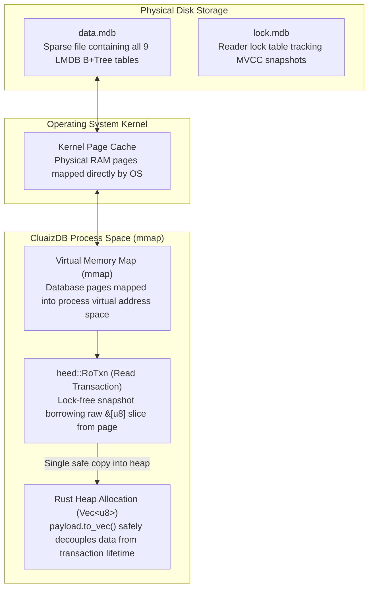
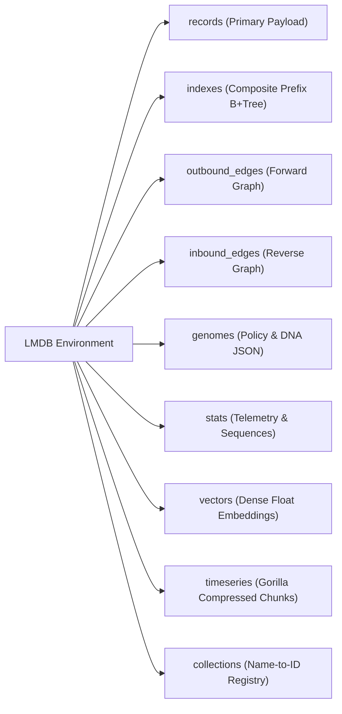
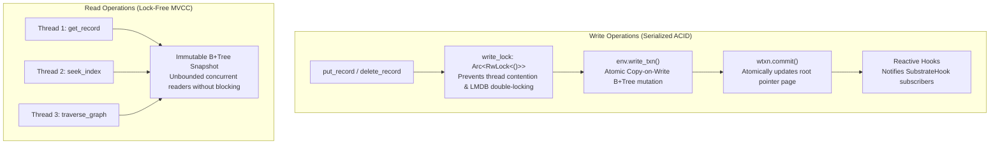

# 🧱 Memory-Mapped B+Tree Storage Substrate

> **Component:** `kernel-core/substrate`  
> **Underlying Engine:** Heed over LMDB (Lightning Memory-Mapped Database)  
> **Reusability Level:** Core Storage Foundation  
> **Thread Safety:** Multi-Threaded MVCC (Lock-free Readers, Serialized Writers)

---

## 🧭 Architectural Flow: Virtual Memory Mapping & The Read Lifecycle

Unlike traditional databases (PostgreSQL, SQLite, MySQL) that implement a user-space buffer cache and incur multiple memory copies on every read:



---

## 🔍 Technical Specification: The Truth About Memory Copies

### 1. Zero Buffer Cache Overhead (At the Storage Engine Layer)
- CluaizDB does not maintain an intermediate user-space buffer pool.
- The OS manages physical RAM caching automatically via the system page cache.
- Point queries traverse the in-memory B+Tree pages via direct virtual address pointer dereferences.

### 2. The Safe Rust API Boundary (The Reality of `to_vec()`)
When a reader queries a record via `StorageSubstrate::get_record`:
```rust
fn get_record(&self, col_id: u32, record_id: u128) -> Result<Option<Vec<u8>>> {
    let rtxn = self.env.read_txn()?;
    let key = encode_record_key(col_id, record_id);
    match self.records_db.get(&rtxn, &key)? {
        Some(bytes) => Ok(Some(bytes.to_vec())), // Safe owned copy to heap
        None => Ok(None),
    }
}
```
- **Fact**: LMDB yields a borrowed slice `&[u8]` that lives only as long as `rtxn`.
- To return owned data across async tasks, channels, and threads without unsafe pointer lifetimes, CluaizDB calls `bytes.to_vec()`.
- **Verdict**: We do not make false "zero-copy across the entire app" claims. The storage layer uses zero-copy memory mapping; the safe Rust interface creates a single owned copy on the heap.

---

## 🗃️ Binary Key Encodings across the 9 Dedicated DBIs

CluaizDB organizes data into 9 named databases (DBIs) inside a single LMDB environment:



### Binary Key Layout Specification:

| Table (DBI) | Key Byte Layout (Big-Endian) | Total Key Size | Value Payload Layout |
| :--- | :--- | :--- | :--- |
| `records` | `ColID [0..4] + RecordID [4..20]` | **20 Bytes** | Raw byte slice (`Vec<u8>`) |
| `indexes` | `ColID [0..4] + TermBytes [4..N] + RecordID [N..N+16]` | **20 + N Bytes** | `()` (Unit byte / 0 bytes) |
| `outbound_edges` | `SourceID [0..16] + EdgeType [16..20] + TargetID [20..36]` | **36 Bytes** | `EdgeMetadata` (Weight 4B + CreatedAt 8B + ValidUntil 8B) |
| `inbound_edges` | `TargetID [0..16] + EdgeType [16..20] + SourceID [20..36]` | **36 Bytes** | `()` (Unit byte / 0 bytes) |
| `genomes` | `GenomeID [0..8]` | **8 Bytes** | Serialized Genome JSON/Bytes |
| `vectors` | `ColID [0..4] + RecordID [4..20]` | **20 Bytes** | IEEE 754 Float Bytes (`&[f32]`) |
| `timeseries` | `SeriesID [0..8] + TimestampMs [8..16]` | **16 Bytes** | Compressed Gorilla byte chunks |
| `collections` | UTF-8 String Name | Variable | `ColID` (4 Bytes Big-Endian) |

---

## 🔒 Concurrency & Mutation Architecture



1. **Readers Never Block Writers, Writers Never Block Readers**:
   - Readers observe a fixed, immutable snapshot determined by the B+Tree root pointer at transaction creation.
   - Even during long-running batch insertions, concurrent queries never encounter lock stalls.
2. **Single Writer Serialization**:
   - LMDB allows only one active write transaction at a time.
   - CluaizDB wraps write transactions with `write_lock: Arc<RwLock<()>>` to ensure graceful queuing without thread panics.

---

## ⚡ Synchronous Reactive Mutation Hooks

The substrate supports in-engine reactive triggers via the `SubstrateHook` trait:

```rust
pub trait SubstrateHook: Send + Sync {
    fn on_record_put(&self, col: u32, id: u128, payload: &[u8]);
    fn on_record_delete(&self, col: u32, id: u128);
    fn on_vector_delete(&self, col: u32, id: u128) {}
}
```

Registered hooks are invoked synchronously immediately upon write transaction commit, enabling real-time index synchronization and audit logging.
