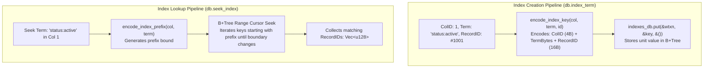
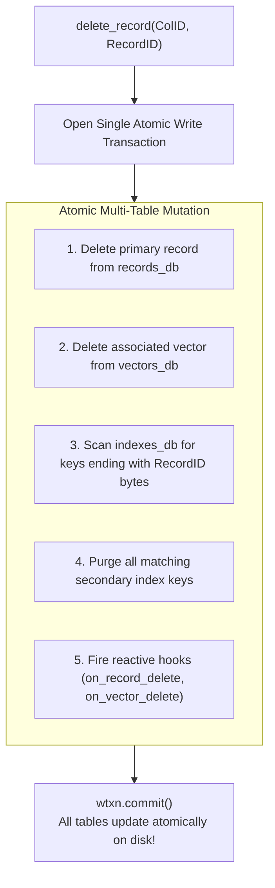

# 📑 Secondary Indexing & Ghost Pointer Purging

> **Component:** `kernel-core/substrate` (`db.rs`, `schema.rs`)  
> **Underlying Table:** `indexes` (`Database<Bytes, Unit>`)  
> **Reusability Level:** Point Lookup & Multi-Tenant Secondary Indexing  
> **Invariant:** Guaranteed Zero Ghost Pointers via Single-Transaction Cleanup

---

## 🧭 Architectural Flow: Prefix Range Seek & Atomic Purging

Secondary indexing allows retrieving record IDs by arbitrary search terms or metadata tags (e.g. `status:active`, `user:1001`) without iterating over the primary data table:



---

## 🗃️ Composite Index Key Specification

The secondary index avoids duplicate key collisions by embedding the target `RecordID` into the B+Tree key itself:

```text
┌─────────────────┬───────────────────────────────┬──────────────────┐
│ ColID (4 Bytes) │ Term Bytes (Variable Length)  │ RecordID (16B)   │
│ Big-Endian u32  │ e.g. "status:active"          │ Big-Endian u128  │
└─────────────────┴───────────────────────────────┴──────────────────┘
```

- **Multi-Tenancy by Default**: Index keys are partitioned by `ColID`. Lookups in Collection 1 can never observe or scan index terms belonging to Collection 2.
- **Unit Value Payload**: The value in `indexes_db` is `()`, consuming **zero value payload bytes**. All information is encoded within the B+Tree key.
- **Multiple Records per Term**: When 100,000 distinct records share the same term `category:electronics`, 100,000 distinct entries sit contiguously in the B+Tree, distinguishable by their trailing 16-byte `RecordID`.

---

## 🛡️ Atomic Cleanup: The Zero Ghost Pointer Invariant

In naive database engines, deleting a record leaves orphaned secondary index pointers ("ghost pointers") if an application crashes or if indices are updated asynchronously.

CluaizDB enforces an **atomic cleanup invariant** executed inside the exact same write transaction as the primary record deletion:



### The Invariant in Code (`db.rs`):
```rust
// 1. Delete primary record
let deleted = self.records_db.delete(&mut wtxn, &key)?;

if deleted {
    // 2. Delete associated vector
    let _ = self.vectors_db.delete(&mut wtxn, &key);

    // 3. Scan & purge ghost index keys pointing to this record
    let prefix = col_id.to_be_bytes();
    let rec_bytes = record_id.to_be_bytes();
    let mut ghost_keys = Vec::new();

    {
        let mut iter = self.indexes_db.iter(&wtxn)?;
        while let Some(res) = iter.next() {
            let (k, ()) = res?;
            if !k.starts_with(&prefix) {
                if k > prefix.as_slice() { break; }
                continue;
            }
            if k.ends_with(&rec_bytes) {
                ghost_keys.push(k.to_vec());
            }
        }
    }

    for k in ghost_keys {
        self.indexes_db.delete(&mut wtxn, &k)?;
    }
}

// 4. Atomically commit all mutations
wtxn.commit()?;
```

Because LMDB transactions are atomic, either **both** the primary record and all secondary pointers are deleted, or the entire transaction aborts. Ghost pointers are physically impossible.
