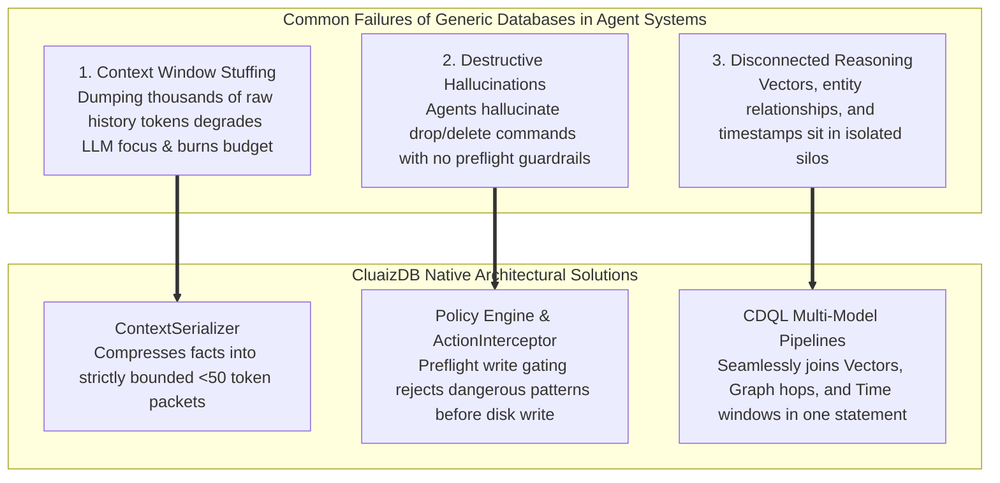

# 🤖 Built for AI Agents

> **Component:** `docs/vision`  
> **Target:** Autonomous LLM Agents, Multi-Agent Swarms & Agent Runtimes  
> **Key Innovations:** Bounded Memory Packets (<50 tokens), Policy Gatekeeper, Unified Knowledge Graph

---

## 🛑 The Three Inherent Failures of Generic Databases for Agents

Traditional databases assume a human developer or a structured web backend issues queries. Autonomous AI Agents operate under fundamentally different constraints:



---

## 📦 1. Context Window Protection (< 50 Tokens Standard)

In standard agent implementations, "retrieval" often means pasting pages of conversation history or JSON into the system prompt:
- **Lost in the Middle**: High token counts degrade model reasoning capability.
- **Cost**: Millions of tokens wasted per day across multi-agent loops.

CluaizDB's `ContextSerializer` formats activated memories into an ultra-dense, bounded string:
```text
[SYSTEM MEMORY: UserPref:Dark-Mode; PreferredLang:Rust; Project:CluaizDB]
```
The output is hard-capped at **190 characters** (~35 to 45 tokens), protecting model attention.

---

## 🛡️ 2. Preflight Policy Gating

When an agent issues a mutating query or tool call:

```mermaid
flowchart LR
    SIGNAL["Agent Signal"] --> GATES{"Preflight Policy Gates<br/>(PolicyDna + Wasm Sandboxes)"}
    GATES -->|Forbidden Pattern (e.g. drop_tables)| REJECT["Immediate Rejection<br/>Zero disk mutation"]
    GATES -->|Compliant| COMMIT["Atomic LMDB Commit"]
```

Even if an autonomous model hallucinates a dangerous command, the substrate intercepts and aborts execution before the transaction touches disk.
