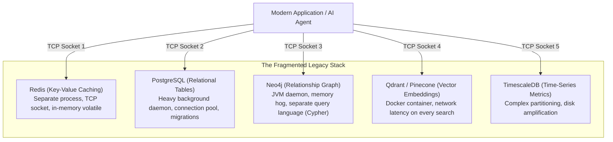
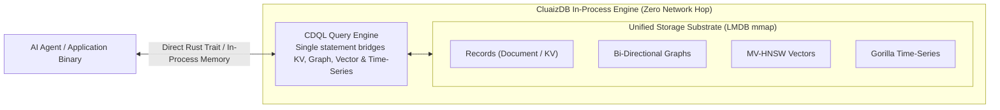

# 💡 Why CluaizDB?

> **Component:** `docs/vision`  
> **Philosophy:** Unified In-Process Cognitive Engine  
> **Target:** AI Agents, Local-First Systems & Autonomous Workflows

---

## 🛑 The Fragmented Modern Database Stack

Modern applications and AI agents juggle separate databases for every workload:



### The Pain Points:
1. **Docker & Daemon Tax**: Developers must configure Docker Compose, manage ports, and burn gigabytes of RAM just for local development.
2. **Network Serialization Overhead**: Every query converts data into JSON or protobuf, crosses local TCP sockets, and incurs kernel context switching.
3. **Application Glue Code**: Developers write fragile Python or TypeScript code to join relational users with vector search results and graph relationships.

---

## ⚡ The CluaizDB Architecture: Multi-Model In-Process Synthesis

CluaizDB was engineered from first principles in Rust to provide a single, embedded storage and query engine:



### 1. In-Process Direct Memory Access
Runs directly inside your application binary using an LMDB-backed virtual memory map. No Docker containers, zero network roundtrip latency.

### 2. Multi-Model Synthesis via CDQL
A single query statement bridges across data models:
```text
find users(active = true) -> get friends -> similar_to(vector: [...], metric: "cosine") -> limit 5
```

### 3. Active Cognitive Governance
Instead of passive dumb storage, CluaizDB provides native agent governance—evaluating safety policies before write operations and providing strictly bounded (< 50 tokens) memory injection to prevent LLM prompt stuffing.
